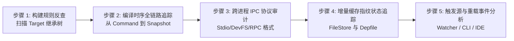
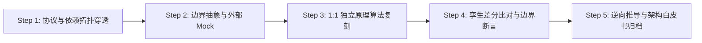
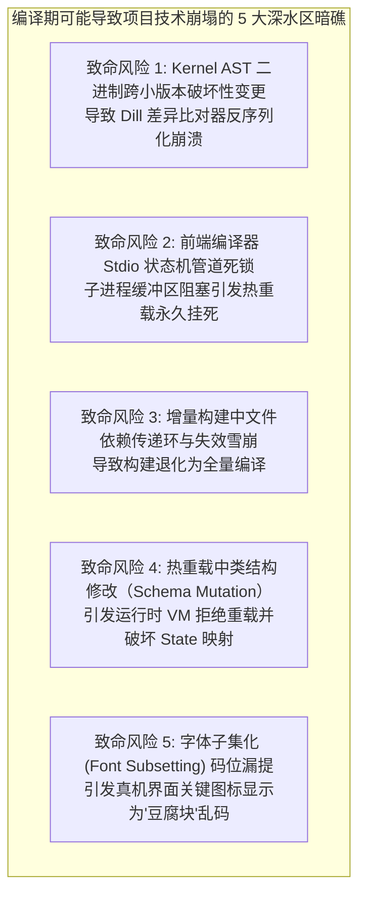

# Flutter 编译期与工具链深度解构与 1:1 原理仿真工程总纲 (Compile-Time Master Blueprint)

> **工程定位**：`Flutter-Anatomy-Lab`（`NanoCompiler` & `NanoToolchain` 编译期仿真引擎）  
> **核心目标**：以本地 `flutter_source`（包含 `flutter_tools`、Dart CFE 前端编译器、`impellerc` 离线着色器编译器、`font_subset` 字体字形裁剪器与 `gen_snapshot` 快照生成器）为唯一客观真理基准，借鉴现代工业级编译系统解构标准，通过**“纵向 5 层流水线”**与**“横向 4 大运行维度”**的正交拆分，运用“5 步地毯式闭环审计法”，建立全量无死角编译期解构计划。  
> **技术路线**：纯 Dart 独立构建编排微内核 + 增量 AST 转换器 + 跨进程编译协议 Stub 桩。

---

## 目录
1. [零遗漏证明：编译期 MECE 黑白灰盒分级边界矩阵](#一-零遗漏证明编译期-mece-黑白灰盒分级边界矩阵)
2. [横向与纵向正交解构模型 (Orthogonal 5 Layers × 4 Workflows)](#二-横向与纵向正交解构模型-orthogonal-5-layers--4-workflows)
3. [Flutter 编译期源码“5 步地毯式闭环审计法”](#三-flutter-编译期源码5-步地毯式闭环审计法)
4. [六大编译核心模块生命周期与接口契约矩阵 (Lifecycle & API Matrix)](#四-六大编译核心模块生命周期与接口契约矩阵-lifecycle--api-matrix)
5. [六大编译模块端到端源码文件穷尽清单 (Zero-Omission Manifest)](#五-六大编译模块端到端源码文件穷尽清单-zero-omission-manifest)
6. [NanoCompiler 模拟器四层重构架构模型](#六-nanocompiler-模拟器四层重构架构模型)
7. [单模块解构执行标准化流程（SOP）与验收标准（DoD）](#七-单模块解构执行标准化流程sop与验收标准dod)
8. [12 周编译期专项攻坚长线路线图 (C0 ~ C5)](#八-12-周编译期专项攻坚长线路线图-c0--c5)
9. [编译期核心技术风险与架构防范机制（Pre-mortem Analysis）](#九-编译期核心技术风险与架构防范机制pre-mortem-analysis)

---

## 一、 零遗漏证明：编译期 MECE 黑白灰盒分级边界矩阵

Flutter 的流畅性与开发体验不仅源于运行时的单次遍历布局与图层合成，更深层次地依赖于其独特的**双模编译体系（开发态 JIT 增量热重载 + 生产态 AOT 极致静态树摇）**。为保证解构工程聚焦核心、杜绝陷入底层 C++ 编译器生成的汇编细节泥潭，建立以下编译期黑白灰盒边界：

```mermaid
flowchart TD
    subgraph WhiteBox [⬜ 白盒核心层 (必须深入源码 1:1 独立原理复刻)]
        W1[构建编排有向无环图: BuildSystem / Target / Node DAG 拓扑解析]
        W2[文件级增量缓存判断: FileStore 哈希指纹 / Depfile .d 依赖语法解析]
        W3[常驻增量编译器通信状态机: ResidentCompiler 与 FrontendServer 交互协议]
        W4[Flutter 专有 AST 变换: TrackWidgetCreation 位置参数注入 / 常量池下沉]
        W5[字体字形树摇器: IconTreeShaker 扫描 AST 码位并驱动裁剪]
        W6[热重载重塑通道: DevFS 增量同步 / VM Service reloadSources 触发 / reassemble 状态保留]
        W7[插件元编程代码合成: DartPluginRegistrant 静态代码模板拼接生成]
    end

    subgraph GrayBox [🟨 灰盒协议层 (接口标准化、协议封包与 Mock 桩)]
        G1[Dart Common Front End (CFE): Kernel AST 序列化格式 (.dill 二进制协议)]
        G2[VM Service JSON-RPC 2.0 调试与重载通信协议]
        G3[Impeller 离线着色器编译桥接: impellerc 命令行参数与 ShaderBundle 结构]
        G4[Native Assets 动态构建钩子协议: build.dart 依赖注入规范]
        G5[AOT 快照生成器桥接: gen_snapshot 命令行开关与 4 大段内存格式]
    end

    subgraph BlackBox [⬛ 黑盒底座层 (前期严格隔离，依赖现有二进制驱动)]
        B1[Dart VM 汇编生成器: SSA 中间表示生成 / 寄存器分配 / 机器码发射内部算法]
        B2[HarfBuzz / FreeType C++ 字体解析渲染器底层实现]
        B3[SPIR-V 交叉编译器底层 (glslang / SPIRV-Cross 内部优化算法)]
        B4[平台原生链接器与打包器: Android AAPT2/D8/R8、iOS ld64/codesign、Xcode 内部构建流水线]
    end

    WhiteBox <==>|指令/协议交互| GrayBox
    GrayBox -. 驱动生产 .-> BlackBox
```

| 分级 | 涉及组件 | 隔离与处理策略 (How to isolate) | 预期收益 (Gain) |
| :--- | :--- | :--- | :--- |
| **黑盒** | `gen_snapshot` 机器指令生成、HarfBuzz 字体解析底层、glslang 语法分析器、AAPT2/Gradle 内部打包 | **严格当作黑盒外部工具链**。调用本地 Flutter SDK 附带的预编译二进制或使用标准 Mock 脚本；输入产物与输出文件严格核验，不自研机器码汇编器。 | 剥离 CPU 指令集架构差异与平台原生打包系统的杂音，聚焦 Flutter 专属的编译编排与增量转换逻辑。 |
| **灰盒** | Kernel AST 二进制规范（.dill）、VM Service JSON-RPC 协议、`impellerc` ShaderBundle 规范、Native Assets hook | **标准化协议与伪桩模拟**。定义 Dart 抽象接口与测试 Mock（如 `MockFrontendServer` 通过假 stdio 响应增量 dill 路径），确保协议与官方实现比特级兼容。 | 保证测试运行不依赖笨重的外部环境，终端纯 Dart 毫秒级闭环，解构协议本质。 |
| **白盒** | DAG 依赖拓扑、增量指纹比对、ResidentCompiler 状态机、Widget 物理坐标注入、DevFS 差分算法、Icon 码位提取 | **100% 深入源码逐行精读，在 `nano_compiler` 中用纯 Dart 1:1 独立重写并进行双轨差分测试。** | 彻底洞悉 Flutter 秒级热重载（Sub-second Hot Reload）、发布态体积缩减与免卡顿渲染的底层黑魔法。 |

---

## 二、 横向与纵向正交解构模型 (Orthogonal 5 Layers × 4 Workflows)

Flutter 编译期是一个横跨“静态构建系统”、“编程语言前端”、“虚拟机代码生成器”与“运行时重载器”的复合工程。必须采用**纵向流水线分层**与**横向工作流维度**相交的二维矩阵进行立体拆解：

```mermaid
flowchart LR
    subgraph VerticalLayers [纵向 5 层流水线架构 (Vertical Hierarchy)]
        direction TB
        L1[Layer 1: 构建图编排与依赖缓存层<br>Build Graph, Target DAG & Depfile Engine]
        L2[Layer 2: 内核 AST 编译与专项变换层<br>Dart Kernel, CFE & Flutter AST Transformers]
        L3[Layer 3: 资产多维树摇与离线着色器编译层<br>IconTreeShaker, AssetBundle & Impellerc]
        L4[Layer 4: AOT 机器指令与快照生成层<br>AOT Snapshotter, TFA & Native Code Generation]
        L5[Layer 5: 增量传输与运行时树重构管道层<br>ResidentCompiler, DevFS & Hot Reload Reshape]
        L1 --> L2 --> L3 --> L4
        L2 -. 增量驱动 .-> L5
    end

    subgraph HorizontalWorkflows [横向 4 大工作流模式 (Horizontal Dimensions)]
        direction TB
        WA[Workflow A: 开发交互流<br>JIT 模式 / 常驻增量编译 / 亚秒级热重载]
        WB[Workflow B: 生产发布流<br>AOT 模式 / 封闭世界假设 / 全局树摇 / 混淆]
        WC[Workflow C: 资产与着色流<br>Shader 离线编译 / 字体子集化 / 二进制清单]
        WD[Workflow D: 元编程与扩展流<br>插件路由代码合成 / Native Assets FFI 编排]
    end
```

### 1. 纵向分层定义 (Vertical 5-Layer Pipeline)
*   **Layer 1：构建图编排与依赖缓存层 (Build Graph & Incremental DAG Layer)**
    *   **核心定位**：Flutter 编译系统的总指挥中枢。
    *   **职责**：解析目标平台与构建模式（Debug/Profile/Release），将构建任务抽象为 `Target` 构成的有向无环图（DAG）；基于 `FileStore` 计算输入输出文件的 SHA-256 散列指纹；读取并生成 Makefile 规范的 `.d` 依赖描述文件（Depfile），实现“输入未变则零编译（No-op build）”。
*   **Layer 2：内核 AST 编译与专项变换层 (Dart Kernel AST & Transformers Layer)**
    *   **核心定位**：Dart 源码到字节码/中间表示（IR）的转换器与增强器。
    *   **职责**：驱动 Dart CFE 将源码编译为 Kernel AST（`.dill` 文件）；在此阶段注入 Flutter 专属的 AST 变换：
        1.  `TrackWidgetCreation`：扫描所有 Widget 实例化调用，注入源码文件、行号、列号（`_Location`），作为 Widget Inspector 的运行时基石；
        2.  `ConstLowering`：规范化常量池，消除冗余不可变实例；
        3.  `@pragma('vm:entry-point')` 保活标记传播。
*   **Layer 3：资产多维树摇与离线着色器编译层 (Asset Tree-Shaking & Impeller Pipeline Layer)**
    *   **核心定位**：体积极致压缩器与首帧掉帧消除器。
    *   **职责**：
        1.  **字体树摇**：通过静态扫描 Kernel AST 提取业务使用的 `IconData(codePoint)` 码位集合（`recorded_uses.json`），调用 `font-subset` 物理裁剪字体文件，将 1.5MB 的字体精简至 10KB；
        2.  **Impeller 离线着色**：调用 `impellerc` 将 GLSL 着色器源码提前在宿主编译为 SPIR-V 与目标平台专用着色格式（MSL / Vulkan SPIR-V），打包为 `ShaderBundle`，彻底终结运行时着色器编译卡顿（Shader Jank）。
*   **Layer 4：AOT 机器指令与快照生成层 (AOT Snapshotting & Code Generation Layer)**
    *   **核心定位**：中间代码向目标物理硬件的最终投影。
    *   **职责**：在 Profile/Release 模式下，将 Layer 2 输出的 `app.dill` 喂给 `gen_snapshot`；通过全局类型流分析（Type Flow Analysis, TFA）移除无用类与方法；将 Dart 逻辑编译为目标机器码（ARM64 / x86_64），组装输出包含 4 大内存段的 Native 共享库（ELF `app.so` 或 Mach-O `App.framework`）：
        - `kSnapshotData` (VM 堆空间初始对象)
        - `kSnapshotInstructions` (VM 通用运行时指令)
        - `kSnapshotData` (Isolate 堆初始对象与不可变常量)
        - `kSnapshotInstructions` (用户业务逻辑 AOT 原生机器码)
*   **Layer 5：增量传输与运行时树重构管道层 (DevFS & Hot Reload Reshape Layer)**
    *   **核心定位**：开发态状态无损极速反馈回路。
    *   **职责**：在 Debug 模式下，维护长生命周期的 `ResidentCompiler` 子进程；当源码修改时，向编译器发送增量编译指令，产出轻量级 Delta Kernel（`.incremental.dill`）；通过 `DevFS` 将增量产物同步至目标设备文件系统；通过 VM Service 触发 `_reloadSources` RPC；VM 加载增量代码后完成类结构重链接，并通知 Framework 执行 `Element.reassemble()`，在 100% 保留 `State` 内存对象的前提下全树重构渲染。

### 2. 横向与纵向交叉矩阵 (The Orthogonal Matrix)

| 纵向分层 \ 横向模式 | Workflow A：开发交互流 (Debug JIT) | Workflow B：生产发布流 (Release AOT) | Workflow C：资产着色流 (Assets/Shader) | Workflow D：元编程扩展流 (Codegen) |
| :--- | :--- | :--- | :--- | :--- |
| **L1 构建编排** | 依赖追踪、快速增量跳过、内存 FileStore | 全量拓扑构建、输出锁定、签名依赖准备 | 资产指纹变动检测、变体解析 | 插件配置感知、Lockfile 变动拦截 |
| **L2 AST 变换** | 开启 `track-widget-creation`、生成 `app.dill` | 关闭调试注桩、强制平台链接 (`linkPlatformKernelIn`) | 生成 `recorded_uses.json` 供树摇消费 | 注入代码生成产物的 package 映射 |
| **L3 资产树摇** | 忽略树摇（全量字体）、着色器动态热重载 | 强制 `IconTreeShaker`、生成紧凑 `AssetManifest.bin` | 编译 `ShaderBundle`、多倍率图筛选 | 收集 Native 动态库资源声明 |
| **L4 AOT 生成** | **跳过该层**（Dart VM JIT 运行 dill） | 执行 `gen_snapshot`、TFA 优化、DWARF 分离 | **不涉及** | 静态打包 Native C-ABI 共享库 |
| **L5 增量重塑** | 激活 `ResidentCompiler`、DevFS 传输、`reassemble` | **跳过该层**（静态封闭运行） | 动态推送变动着色器至 DevFS | **不涉及** |

---

## 三、 Flutter 编译期源码“5 步地毯式闭环审计法”

对标总纲的闭环审计体系，针对编译期建立“从命令行触发到二进制工件落地”的 5 维扫描规则：



### 步骤 1：基于构建系统目标反查“绝对责任清单”
*   **方法**：
    *   检索 `packages/flutter_tools/lib/src/build_system/targets/` 下所有继承自 `Target` 的基类与派生类。
    *   审查每一个 Target 的 `inputs`、`outputs` 与 `dependencies` 契约，建立完整的构建依赖森林（Dependency Forest）。

### 步骤 2：编译时序串联追踪 (Compilation Pipeline Tracing)
从终端命令敲下到产物被引擎加载的端到端时序：
1.  **命令入口与环境组装**：`flutter_tools/runner.dart` $\rightarrow$ `build` / `run` 命令 $\rightarrow$ 初始化 `BuildSystem` 与 `Environment`。
2.  **构建图解析与剪枝**：`BuildSystem.build()` 拓扑排序计算依赖图 $\rightarrow$ 执行 `Target.canSkip()` 基于指纹判定跳过项。
3.  **内核编译调用**：`KernelSnapshot.build()` $\rightarrow$ 组装参数调用 `KernelCompiler` $\rightarrow$ 调起 `frontend_server.dart.snapshot` 编译输出 `app.dill`。
4.  **树摇与着色器介入**：`IconTreeShaker` 读取 AST 码位输出裁剪后 TTF；`ShaderCompiler` 调用 `impellerc` 输出着色器快照。
5.  **AOT 机器码投影**：`AotSnapshotBase.build()` 调起 `AOTSnapshotter` $\rightarrow$ 派生 `gen_snapshot` 进程输出 ELF `app.so`。
6.  **宿主产物组装**：调用平台后端打包（Android Gradle `flutter.gradle` 将 `app.so` 打入 APK `lib/` 目录）。

### 步骤 3：跨进程与跨模块协议审计 (Protocol & IPC Auditing)
梳理编译期涉及的跨进程标准通信契约：
1.  **ResidentCompiler 通信协议**：标准输入输出（stdin/stdout）基于文本行与行首标记通信（`compile <path>`、`recompile <boundaryKey>`、`accept`、`reject`、`quit`）。
2.  **DevFS 协议**：基于 VM Service WebSocket 的 JSON-RPC 请求，传输文件路径与 base64 编码的字节切片。
3.  **快照二进制结构契约**：分析 `engine/src/flutter/runtime/dart_snapshot.cc` 对 ELF 符号表中 `kSnapshotData` 与 `kSnapshotInstructions` 的映射解析规范。

### 步骤 4：增量缓存指纹状态血缘追踪 (Hash Fingerprinting & Invalidation)
编译性能的关键在于精确识别变更。必须对以下状态判断逻辑建立血缘追踪：
*   **`FileStore` 的失效判定**：何时基于文件的修改时间（`stat().modified`）粗筛？何时基于 SHA-256 摘要细筛？
*   **`Depfile` 级联推导**：当底层某个 `.dart` 头文件修改时，如何沿着 Makefile 依赖反向将所有下游产物标记为 dirty。
*   **Target 的 `canSkip` 契约**：哪些环境变量（如 `--dart-define`、`--flavor`）的变动会击穿缓存直接强制重编？

### 步骤 5：外部中断与触发源驱动 (Trigger Ingress)
梳理触发编译动作的外部源头：
1.  **用户离线主动触发**：`flutter build apk / ios / bundle`（一次性全量构建流水线）。
2.  **IDE / 终端实时交互**：`flutter run` 启动常驻会话，监听终端按键（`r` $\rightarrow$ 热重载，`R` $\rightarrow$ 热重启）。
3.  **文件监视器自动触发**：文件系统事件（`FileWatcher`）感知源码修改，自动防抖触发增量构建。

---

## 四、 六大编译核心模块生命周期与接口契约矩阵 (Lifecycle & API Matrix)

将编译期横向与纵向交织的系统，凝炼为**六大高内聚核心模块（模块 C1 ~ 模块 C6）**：

| 模块编号与名称 | 初始化/激活时机 (Lifecycle Entry) | 核心内部状态机与持有对象 | 对外核心 API / 任务契约 (Exported APIs) | 销毁/产物交付时机 (Teardown & Artifact) |
| :--- | :--- | :--- | :--- | :--- |
| **模块 C1：构建编排引擎与增量缓存驱动** (BLD) | `flutter build/run` 命令初始化 `BuildSystem` | `Node` 拓扑图、`FileStore` 内存哈希表、`DepfileService` | `build(Target, Environment)`, `canSkip()`, `findInvalidated()` | 构建完毕将文件哈希持久化至磁盘 `.flutter-plugins-dependencies` |
| **模块 C2：Dart Kernel 前端编译与 AST 变换** (KRN) | 首次执行 `KernelSnapshot` 构建任务 | `KernelCompiler`、`TargetModel`、AST 访问器状态 | `compile(mainPath, sdkRoot)`, AST 注入 `TrackWidgetCreation` | 生成根目录 `app.dill` 与符号依赖表，退出或驻留常驻池 |
| **模块 C3：增量编译守护、DevFS 与热重载** (HOT) | `flutter run` 启动 `HotRunner` 并连接设备 | `ResidentCompiler` (Stdio 进程通道)、`DevFS` 追踪器 | `recompile()`, `accept()`, `reject()`, `reloadSources()`, `reassemble()` | 用户退出交互调试会话（`q`），杀死常驻编译器与清理 DevFS |
| **模块 C4：AOT 快照编译与多段二进制生成** (AOT) | 执行 Profile/Release 模式的 `AotSnapshotBase` | `AOTSnapshotter`、`GenSnapshot` 参数生成器 | `build(platform, buildMode, dillPath, outputPath)` | 产出物理共享库 `app.so` / `App.framework`，剥离 DWARF 符号 |
| **模块 C5：资产多维树摇与离线着色器编译** (SHK) | `CopyFlutterBundle` 与 `AssetBundle.build()` | `IconTreeShaker` (持有码位集)、`ShaderCompiler` (持有并发池) | `copyAssets()`, `compileShader()`, `subsetFont()` | 输出精简版 `MaterialIcons-Regular.otf` 与 `ShaderBundle` 字节流 |
| **模块 C6：插件自动注册元编程与 Native Assets** (GEN) | `flutter pub get` 完成后或构建第一步 | `PackageConfig` 字典、Mustache 模板渲染器 | `generateMainDartWithPluginRegistrant()`, `BuildHooks.build()` | 生成 `.dart_tool/flutter_build/dart_plugin_registrant.dart` |

---

## 五、 六大编译模块端到端源码文件穷尽清单 (Zero-Omission Manifest)

源码基准绝对路径：`/Volumes/MacBookData/workspace/flutter-anatomy/flutter_source/flutter`

### 模块 C1：构建编排引擎与 DAG 增量缓存机制 (BLD)
*   **构建编排核心** (`packages/flutter_tools/lib/src/build_system/`):
    *   `build_system.dart` —— `BuildSystem` 调度中枢、`Target` 抽象基类、`Environment` 构建上下文
    *   `build_targets.dart` —— 构建目标字典与默认目标集合
    *   `file_store.dart` —— 文件内容散列比对器与增量指纹持久化引擎
    *   `depfile.dart` —— Makefile 格式依赖描述文件解析器与生成器
    *   `source.dart` —— 灵活声明输入输出的 `Source` 抽象（模式匹配、环境变量求值、工件引用）
    *   `hash.dart` —— 高性能文件流 SHA-256 增量哈希计算
    *   `exceptions.dart` —— 构建阶段异常定义（MissingDefineException, CircularDependencyException）
*   **通用构建目标** (`packages/flutter_tools/lib/src/build_system/targets/`):
    *   `common.dart` —— `KernelSnapshot`、`AotSnapshotBase`、`CopyFlutterBundle` 基础目标定义

### 模块 C2：Dart Kernel 前端编译与 AST 专项变换 (KRN)
*   **编译器前端调用桥接** (`packages/flutter_tools/lib/src/`):
    *   `compile.dart` —— `KernelCompiler`、`ResidentCompiler`、`DefaultResidentCompiler`、`TargetModel`
    *   `artifacts.dart` —— 编译器预编译工件路径寻址器（`frontend_server.dart.snapshot`、`patched_sdk`）
    *   `build_info.dart` —— `BuildMode`（debug/profile/release）、编译选项解构
*   **引擎侧前端编译器接入** (`engine/src/flutter/flutter_frontend_server/`):
    *   `BUILD.gn` —— 编译输出 `frontend_server_aot.dart.snapshot`
    *   `pubspec.yaml` —— 声明 Dart 语言前端 CFE 依赖
*   **AST 变换规范** (参照 Dart SDK CFE 源码逻辑):
    *   `TrackWidgetCreation` 构造器行号列号注桩规范（注入 `$creationLocation` 字段）
    *   `ConstCanonicalization` 跨文件不可变对象合并机制

### 模块 C3：增量编译守护、DevFS 传输与热重载重构 (HOT)
*   **常驻运行中枢** (`packages/flutter_tools/lib/src/`):
    *   `run_hot.dart` —— `HotRunner`、`_reloadSources`、`_hotReloadHelper`、状态防抖与耗时度量
    *   `resident_runner.dart` —— 交互式命令行键盘事件分发器（`r` / `R` / `q`）
    *   `devfs.dart` —— 内存虚拟文件系统、文件内容差分提取、增量字节流序列化
    *   `vmservice.dart` —— Dart VM Service JSON-RPC 客户端封装、隔离区（Isolate）重载驱动
*   **运行时状态无损协同** (`packages/flutter/lib/src/widgets/`):
    *   `framework.dart` —— `Element.reassemble()` 遍历标记全部节点脏状态并保留 `State`

### 模块 C4：生产态 AOT 快照编译与多段二进制生成 (AOT)
*   **快照构建器驱动** (`packages/flutter_tools/lib/src/base/` 及 `build_system/targets/`):
    *   `build.dart` —— `AOTSnapshotter`、`GenSnapshot` 物理参数组装（`--snapshot-kind=app-aot-elf`）
    *   `targets/common.dart` —— `AotSnapshotProfile`、`AotSnapshotRelease` 目标声明
    *   `targets/android.dart` —— Android 平台生成 `libapp.so`
    *   `targets/darwin.dart` / `ios.dart` —— Apple 平台生成 `App.framework`
*   **引擎底层快照消费者** (`engine/src/flutter/runtime/`):
    *   `dart_snapshot.h / .cc` —— 映射 ELF 段到 `vm_snapshot_data`、`vm_snapshot_instr`、`isolate_snapshot_data`、`isolate_snapshot_instr`
    *   `dart_vm.cc` —— 接收 4 大内存段初始化 Dart 虚拟机堆空间

### 模块 C5：资产多维树摇与离线着色器编译 (SHK)
*   **字体子集裁剪体系** (`packages/flutter_tools/lib/src/build_system/targets/` 及 `engine/`):
    *   `targets/icon_tree_shaker.dart` —— 解析 `recorded_uses.json`，调度 `font-subset` 物理裁剪
    *   `engine/src/flutter/tools/font_subset/main.cc` —— C++ 基于 HarfBuzz 的字形裁剪命令行工具
    *   `engine/src/flutter/tools/font_subset/hb_wrappers.h` —— HarfBuzz 字体封装
*   **Impeller 离线着色器流水线** (`packages/flutter_tools/lib/src/build_system/tools/` 及 `engine/`):
    *   `tools/shader_compiler.dart` —— `ShaderCompiler`、`DevelopmentShaderCompiler`（开发态着色器热重载）
    *   `engine/src/flutter/impeller/compiler/impellerc_main.cc` —— 离线着色器编译器入口
    *   `engine/src/flutter/impeller/compiler/compiler.cc` —— GLSL 转换为 SPIR-V / MSL
    *   `engine/src/flutter/impeller/compiler/shader_bundle.cc` —— 离线打包为多后端 `ShaderBundle`
*   **通用资产打包** (`packages/flutter_tools/lib/src/`):
    *   `asset.dart` —— `AssetBundle`、`AssetManifest.bin` 紧凑二进制格式序列化
    *   `build_system/targets/assets.dart` —— `copyAssets` 构建目标实现

### 模块 C6：插件自动注册元编程与 Native Assets (GEN)
*   **插件路由静态合成** (`packages/flutter_tools/lib/src/build_system/targets/`):
    *   `targets/dart_plugin_registrant.dart` —— `DartPluginRegistrantTarget` 目标驱动
    *   `flutter_plugins.dart` —— 解析 `pubspec.yaml` 插件映射，生成 `dart_plugin_registrant.dart`
*   **Native Assets 静态绑定** (`packages/flutter_tools/lib/src/build_system/targets/` 及 `isolated/`):
    *   `targets/native_assets.dart` —— `BuildHooks` 目标，驱动执行各 package 根目录下的 `build.dart`
    *   `isolated/native_assets/native_assets.dart` —— C/C++ FFI 源码编译与产物链接

---

## 六、 NanoCompiler 模拟器四层重构架构模型

为摆脱对数百兆 Dart SDK 工具链与外部 C++ 二进制的强依赖，`NanoCompiler` 建立纯纯用户态四层模拟沙盒：

```
+--------------------------------------------------------------------------+
4. 编译观测、分析与差分验证层 (Test Harness, AST Inspector, Dill Diff Tool)
   - Dill 差异比对器: 比对官方 dill 与自研编译器输出的 AST 节点与符号表
   - 依赖图拓扑导出器: 终端导出 ASCII DAG 树与循环依赖诊断器
+--------------------------------------------------------------------------+
3. 编译期元编程与静态注桩层 (NanoCodegen & NanoTransformers)
   - TrackWidgetCreation 简易 AST Visitor: 自动为 Widget 添加构造位置参数
   - NanoPluginRegistrant: 纯 Dart 模板生成器，自动化生成插件注册引导代码
+--------------------------------------------------------------------------+
2. 核心编排调度与增量缓存算法层 (NanoBuildSystem & NanoDevFS)
   - NanoBuildSystem: 纯 Dart 实现的有向无环图 (DAG) 拓扑排序调度器
   - NanoFileStore: SHA-256 增量摘要比对与 .d 依赖语法解析器
   - NanoResidentController: Stdio 文本交互状态机仿真器
+--------------------------------------------------------------------------+
1. 外部编译器协议 Mock 桩与沙盒 (External Compiler Mock & Subprocess Stub)
   - MockFrontendServer: 拦截命令行/Stdio，以预录快照形式返回增量 dill
   - MockImpellerc: 模拟着色器编译过程，输出结构化伪着色指令包
   - MockFontSubsetter: 记录码位过滤调用，断言输入码位无遗漏
   - VirtualFileSystem: 纯内存虚拟文件系统（用于秒级单元测试隔离）
+--------------------------------------------------------------------------+
```

---

## 七、 单模块解构执行标准化流程（SOP）与验收标准（DoD）

编译期各个模块的攻坚同样严格遵守以下标准化 SOP 与四大验收指标（DoD）：



### 1. 标准执行五步法（SOP）
*   **Step 1：协议与依赖拓扑穿透（Code Anatomy）**
    *   绘制模块输入文件、输出文件、依赖的 CLI 开关与环境变量；绘制 DAG 依赖关系图。
*   **Step 2：边界抽象与外部 Mock（Protocol & Mocking）**
    *   将底层外部依赖（如 `frontend_server`、`impellerc`、`gen_snapshot`）封装为强类型抽象接口，并编写毫秒级 Mock 桩。
*   **Step 3：1:1 原理级独立微内核代码复刻（1:1 Minimal Reproduction）**
    *   在 `nano_compiler` 中用纯 Dart 编写独立算法。
    *   核心类名、状态机标志位（如 `canSkip`、`recompile`、`accept`、`inputs`）与官方代码 100% 对齐。
*   **Step 4：双轨测试与官方孪生差分对齐（Differential Testing）**
    *   构造同一组源码工程，分别输入官方 `flutter_tools` 与 `nano_compiler`，比对产出的依赖图、构建顺序、AST 注入节点。
*   **Step 5：逆向架构推导与原理白皮书归档（Reverse-Engineering Docs）**
    *   在 `docs/principles/` 产出高质量分析文档，回答“为什么 Flutter 要将编译流水线设计为增量常驻模式？”。

### 2. 最终验收标准 (Definition of Done - DoD)

```
┌────────────────────────────────────────────────────────────────────────┐
│                     编译期模块解构验收标准 (DoD)                       │
├────────────────────┬───────────────────────────────────────────────────┤
│ 1. 代码复刻度验收  │ • 零第三方黑盒依赖（纯标准 Dart 库实现）            │
│    (Code Fidelity) │ • 状态机变迁与官方源码逻辑 1:1 等价                │
│                    │ • 依赖图无死锁，进程交互异常时能优雅自愈          │
├────────────────────┼───────────────────────────────────────────────────┤
│ 2. 测试与差分验收  │ • 单元测试覆盖率 > 90% (覆盖所有异常中断流)        │
│    (Testing DoD)   │ • 增量判定一致性: 官方判定 skip 的 nano 必须 skip  │
│                    │ • AST 注桩差异: 关键行号列号注入位置 100% 对齐    │
├────────────────────┼───────────────────────────────────────────────────┤
│ 3. 观测与自省验收  │ • 具备在控制台一键 Dump 完整构建 DAG 拓扑的能力     │
│    (Observability) │ • 能实时输出每个文件失效的原因 (InvalidatedReason) │
├────────────────────┼───────────────────────────────────────────────────┤
│ 4. 原理白皮书验收  │ • 包含标准 Mermaid 时序图与通信协议帧格式          │
│    (Documentation) │ • 深度解析 AOT 4 大段内存结构与热重载状态保留机制  │
│                    │ • 包含如果缺少该机制引发的灾难反证实验总结         │
└────────────────────┴───────────────────────────────────────────────────┘
```

---

## 八、 12 周编译期专项攻坚长线路线图 (C0 ~ C5)

| 阶段 | 周期 | 攻坚模块 | 核心交付物 | 阶段验收门禁 (Exit Criteria) |
| :--- | :--- | :--- | :--- | :--- |
| **阶段 C0** | 第 1~2 周 | **模块 C1**<br>(构建编排引擎 / DAG / Depfile) | • `NanoBuildSystem` 调度器<br>• `NanoFileStore` 指纹持久化<br>• Makefile `.d` 依赖解析器 | 构造 10 个互斥与依赖 Target，拓扑执行顺序 100% 正确；修改上游文件精准触发下游重编，未变动文件 100% `canSkip`。 |
| **阶段 C1** | 第 3~4 周 | **模块 C2**<br>(Dart Kernel 前端 / AST 变换) | • `KernelCompiler` 驱动封装<br>• `TrackWidgetCreation` 注入器<br>• MockFrontendServer 桩 | 模拟源码编译，输出的 AST 中每个 Widget 构造函数均成功注入精准的 `_Location` 物理坐标参数。 |
| **阶段 C2** | 第 5~6 周 | **模块 C3**<br>(常驻守护 / DevFS / 热重载) | • `ResidentCompiler` Stdio 状态机<br>• `NanoDevFS` 差分同步器<br>• 热重载状态重塑沙盒 | 连续模拟 5 次源码修改，增量 Delta Dill 计算与 Stdio `accept/reject` 交互无死锁，正确触发 UI 树 `reassemble` 且 `State` 保持。 |
| **阶段 C3** | 第 7~8 周 | **模块 C5**<br>(字体树摇 / Impeller 离线着色) | • `IconTreeShaker` AST 码位解析器<br>• `ShaderCompiler` 封装桩<br>• `AssetManifest.bin` 生成器 | 精确从 AST 提取使用到的所有 Icon 码位，生成的 TTF 子集体积降低 90% 以上；着色器离线打包为合法 ShaderBundle。 |
| **阶段 C4** | 第 9~10 周 | **模块 C6 & 模块 C4**<br>(元编程代码生成 / AOT 快照) | • `DartPluginRegistrant` 生成器<br>• `AOTSnapshotter` 参数组装器<br>• 4 大内存段结构解析器 | 依据 `pubspec.yaml` 自动化合成插件路由文件；正确解析并比对官方 `app.so` 的 4 大内存段布局与符号表。 |
| **阶段 C5** | 第 11~12 周 | **全链路编译与差分结项**<br>(端到端闭环 / 白皮书归档) | • 《Flutter 编译期与工具链深度解构白皮书》<br>• NanoCompiler 与官方工具链孪生差分报告 | 纯自研 `nano_compiler` 能够独立接管并成功编排出符合运行期 `nano_flutter` 消费规格的完整包体。 |

---

## 九、 编译期核心技术风险与架构防范机制（Pre-mortem Analysis）

编译期解构横跨多进程与二进制协议，在实施过程中存在以下 **5 大核心致命技术风险**，必须前置设立架构防波堤：



### 1. 致命风险 1：Kernel AST 二进制格式跨小版本的破坏性不兼容
*   **风险机理**：
    Dart Kernel AST（`.dill`）不是长期稳定的文件格式，其二进制 Tag 编码随 Dart SDK 小版本升级而变动。若直接用二进制字节比对官方与自研产物，即使语义 100% 一致，也会因格式版本微差导致差分测试大面积红斑崩溃。
*   **架构防范方案**：
    *   **锁定统一 SDK 基准**：全局强制绑定 `./flutter_source/flutter/bin/dart`，禁止使用宿主系统的任意第三方 Dart 版本。
    *   **语义树差异比对 (AST Semantic Diff)**：差分比对不对比原始二进制流，而是将 `.dill` 转换为人类可读的 AST 文本表示（Dump format），针对类名、字段名、方法体指令序列进行语义级等价断言。

### 2. 致命风险 2：常驻编译器 Stdio 文本交互状态机死锁与管道阻塞
*   **风险机理**：
    `DefaultResidentCompiler` 与 `frontend_server` 通过 stdin/stdout 进行长连接双向通信。如果某条编译报错输出超出操作系统管道缓冲区（通常 64KB）且没有及时异步消费，或者前端由于语法错误未吐出预期的结束符，主进程会陷入永久 `await` 死锁。
*   **架构防范方案**：
    *   **非阻塞双工流缓冲区封装**：独立封装 `ResidentStreamHandler`，以行（LineSplitter）为单位消费标准输出，所有响应设置严格的看门狗超时（Watchdog Timeout, 10 秒超时强杀并报错）。
    *   **明确错误状态转移**：收到前端报错时，状态机必须强行迁移至 `rejected` 状态并执行通道清空（Drain），杜绝残存脏数据污染下一轮交互。

### 3. 致命风险 3：依赖图中的循环依赖与级联失效雪崩
*   **风险机理**：
    在复杂项目中，Dart 代码通过 `part`、`export` 与多向 `import` 容易形成传递依赖网络。若 Depfile 依赖收集算法存在缺陷，一个深层叶子文件的微小时间戳跳动会导致依赖图上所有节点全量失效，使增量编译退化为全量编译。
*   **架构防范方案**：
    *   **内容哈希防线（Content-Hash Barrier）**：时间戳比对仅作为初步命中候选；只有当且仅当文件内容的 SHA-256 散列值真正突变时，才标记下游节点失效。
    *   **拓扑环形检测断言**：在构建 DAG 初始化时，利用 Tarjan 算法检测有向图中的强连通分量，若发现非法回环立即阻断并输出精准错误堆栈。

### 4. 致命风险 4：热重载类结构修改引发 VM 拒绝与状态撕裂
*   **风险机理**：
    Flutter 热重载具有严格的限制（禁止给已有类增删字段、禁止修改类继承关系、禁止修改枚举）。若开发者修改了类结构，Dart VM Service 会抛出 `kIsolateReloadBarred` 异常。若系统未正确识别该异常，强行派发 `reassemble()`，会导致新旧对象内存内存布局不匹配，引发原生 `SIGSEGV` 内存破坏。
*   **架构防范方案**：
    *   **Schema 预检与降级保护**：在触发 `reloadSources` 前，差分扫描类定义元数据；若检测到字段变动，主动拦截热重载并向开发者提示必须执行热重启（Hot Restart, `R`）。
    *   **状态保留原子回滚**：如果 VM 报错，立即向编译器发送 `reject` 指令回滚编译器内部状态，保持运行时旧代码与内存状态的完整性。

### 5. 致命风险 5：字形树摇码位漏提，引发运行时界面关键图标乱码
*   **风险机理**：
    `IconTreeShaker` 依靠扫描 Kernel AST 中的常量构造函数参数来识别 `IconData(0xe123)`。若业务代码通过动态变量传参（例如 `IconData(myCodePoint)`）或反射创建图标，静态 AST 扫描无法提取该码位，导致该图标被 `font-subset` 物理剔除，运行时在界面上显示为未知字符（空白或豆腐块框）。
*   **架构防范方案**：
    *   **动态未知码位逃逸分析与警告**：当检测到非常量 `IconData` 实例化时，在编译日志中输出强警告，并自动向保留码位集注入兜底保留策略（或提供白名单机制）。
    *   **双轨字形验证用例**：单测中构造包含动态码位、第三方包码位与常量码位的混合测试工程，断言树摇器的码位提取准确率达到 100%。
