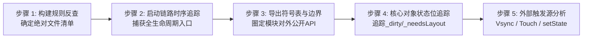
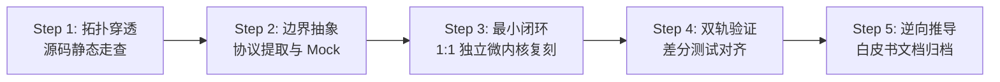
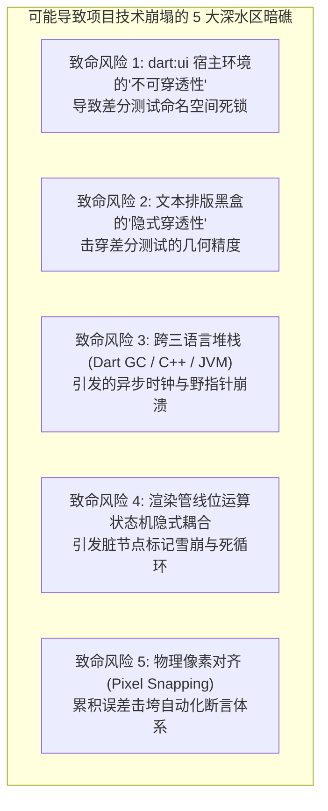

# Flutter 架构深度解构与 1:1 原理仿真工程总纲 (Master Blueprint)

> **工程定位**：`Flutter-Anatomy-Lab`（`NanoFlutter` 微内核仿真引擎）  
> **核心目标**：以本地 `flutter_source` 为唯一客观真理基准，借鉴操作系统内核解构标准（`docs/Linux.md`），通过**“5 步地毯式闭环扫描”**、**“四层模拟器抽象”**、**“全量代码边界划定”**与**“孪生差分测试”**，在数月周期内彻底吃透 Flutter 端到端底层运作机制。  
> **技术路线**：方案 A（纯 Dart 逻辑微内核 + 现代 C++ 宿主桥接层）。

---

## 目录
1. [零遗漏证明：MECE 黑白灰盒分级边界矩阵](#一-零遗漏证明mece-黑白灰盒分级边界矩阵)
2. [Flutter 源码“5 步地毯式闭环审计法”（无死角扫描）](#二-flutter-源码5-步地毯式闭环审计法无死角扫描)
3. [八大核心模块生命周期与接口契约矩阵 (Lifecycle & API Matrix)](#三-八大核心模块生命周期与接口契约矩阵-lifecycle--api-matrix)
4. [八大模块端到端源码文件穷尽清单 (Zero-Omission Manifest)](#四-八大模块端到端源码文件穷尽清单-zero-omission-manifest)
5. [NanoFlutter 模拟器四层重构架构模型](#五-nanoflutter-模拟器四层重构架构模型)
6. [单模块解构执行标准化流程（SOP）与验收标准（DoD）](#六-单模块解构执行标准化流程sop与验收标准dod)
7. [20 周多阶段长线工程全景路线图](#七-20-周多阶段长线工程全景路线图)

---

## 一、 零遗漏证明：MECE 黑白灰盒分级边界矩阵

借鉴 Linux 内核解构思想，解构复杂系统的第一要务是建立**认知防波堤**，确保核心逻辑白盒透彻，底座杂音严格黑盒隔离：

```mermaid
flowchart TD
    subgraph WhiteBox [⬜ 白盒核心层 (必须深入源码 1:1 独立原理复刻)]
        W1[三棵树状态机: Widget/Element/RenderObject/State]
        W2[单次遍历盒约束管线: BoxConstraints/RelayoutBoundary]
        W3[图层树合成系统: LayerTree/RepaintBoundary]
        W4[输入拓扑与手势竞技场: HitTest/GestureArenaManager]
        W5[并发线程模型与消息泵: FML MessageLoop/TaskRunner]
    end

    subgraph GrayBox [🟨 灰盒协议层 (接口标准化、高效透传与 Stub 桩)]
        G1[C-ABI / Dart FFI 跨语言零拷贝桥接]
        G2[Android Choreographer 硬件帧脉冲捕捉]
        G3[SurfaceView / ANativeWindow 表面呈现]
        G4[MockCanvas / 矢量指令流记录器]
        G5[MockParagraph / 简易字符排版模型]
    end

    subgraph BlackBox [⬛ 黑盒底座层 (前期严格隔离，仅依赖标准运行环境)]
        B1[Dart VM: 编译器汇编生成 / JIT / AOT / 垃圾回收GC内部算法]
        B2[Skia/Impeller: GPU 着色器编译 / 贝塞尔三角剖分 / VBO 顶点缓冲]
        B3[HarfBuzz/ICU: 复杂文字塑形 / 连字匹配 / Unicode Bidi 排版]
        B4[Linux Kernel / 显卡芯片驱动 / EGL 驱动底层细节]
    end

    WhiteBox <==>|接口调用| GrayBox
    GrayBox -. 驱动底座 .-> BlackBox
```

| 分级 | 涉及组件 | 隔离与处理策略 (How to isolate) | 预期收益 (Gain) |
| :--- | :--- | :--- | :--- |
| **黑盒** | Dart VM 编译器、Skia/Impeller 着色器、HarfBuzz/ICU 复杂字型、GPU EGL 交换链 | **严格当作黑盒**。Dart 直接使用现有 SDK 运行时执行；Canvas 抽象为 `MockCanvas` 记录绘制指令；文字排版初期基于字符数估算盒模型。 | 抽离平台与图形硬件无关杂音，聚焦渲染流水线、排版数学模型与三棵树核心状态机。 |
| **灰盒** | C-ABI 导出层、Android Choreographer 帧脉冲、Surface 载体绑定 | **定义标准最小协议**。C++ 导出 C 函数供 Dart FFI 直连；Android Vsync 通过 JNI 透传，终端环境下由高精度定时器等价替换。 | 保证时钟对齐时序与真实设备 100% 等价，消除通信协议开销。 |
| **白盒** | FML 线程、渲染管线、单次遍历布局、三棵树 Diff、Layer 合成、手势竞技场 | **100% 深入源码逐行精读，并在 `nano_flutter` 中用纯 Dart / C++ 进行 1:1 独立重写与测试断言。** | 彻底洞悉 Flutter 响应式设计、单次遍历不回流机制、局部重绘隔离的核心机密。 |

---

## 二、 Flutter 源码“5 步地毯式闭环审计法”（无死角扫描）

对标 `Linux.md` 第四节，为确保任何一个模块都不会出现“漏掉关键文件或隐蔽机制”，建立以下 5 维代码扫描审计法则：



### 步骤 1：基于构建文件拉取“绝对文件清单”
*   **方法**：
    *   Framework 侧：查阅 `packages/flutter/pubspec.yaml` 与各库的顶级导出文件（如 `packages/flutter/lib/rendering.dart` 中所有的 `export 'src/rendering/...';`），凡未被导出的内部实现文件逐一核验。
    *   Engine 侧：查阅 `engine/src/flutter/BUILD.gn` 与 `engine/src/flutter/shell/platform/android/BUILD.gn`，提取所有 `sources = [...]` 参与编译的 C++/Java 文件，杜绝漏掉受控特性。

### 步骤 2：启动时序串联法 (Initialization Tracing)
所有子模块的初始化入口，必沿主启动调用链被显式挂载，全程顺藤摸瓜：
1.  **Android 宿主启动**：`FlutterApplication` $\rightarrow$ `FlutterActivity.onCreate()` $\rightarrow$ 创建 `FlutterEngine`。
2.  **C++ 引擎与线程池就绪**：`FlutterJNI.init()` $\rightarrow$ `Shell::Create()` $\rightarrow$ 初始化 Platform/UI/Raster/IO 4 大 TaskRunner $\rightarrow$ 创建 `Animator` 与 `Engine` 实例。
3.  **Dart Isolate 诞生**：加载 `isolate_snapshot` $\rightarrow$ `DartExecutor.executeDartEntrypoint()` $\rightarrow$ 执行用户 `main()`。
4.  **Framework 绑定叠加**：`runApp()` 触发 `WidgetsFlutterBinding.ensureInitialized()`，沿 `BindingBase` 链式叠加：
    $$\text{BindingBase} \rightarrow \text{SchedulerBinding} \rightarrow \text{ServicesBinding} \rightarrow \text{PaintingBinding} \rightarrow \text{RendererBinding} \rightarrow \text{GestureBinding} \rightarrow \text{WidgetsBinding}$$
5.  **首帧驱动挂载**：`attachRootWidget()` 创建 `RenderView` 与 `RootElement` $\rightarrow$ 请求 Vsync $\rightarrow$ 首次 Pipeline 流水线运转。

### 步骤 3：跨层导出符号表审计 (Exported Symbols & Boundaries)
对标 Linux 的 `EXPORT_SYMBOL`，分析各层对外承诺暴露的 API 契约：
1.  **C++ 对 Dart 导出**：扫描 `engine/src/flutter/lib/ui/dart_ui.cc` 中的 `DART_REGISTER_NATIVE_STATIC` 注册表，这就是 `dart:ui` 的全部真面目（Canvas, PictureRecorder, SceneBuilder, Window）。
2.  **Java 对 C++ JNI 导出**：扫描 `platform_view_android_jni_impl.cc` 中的 `RegisterNatives`，圈定 Android 宿主调用 C++ 的边界。
3.  **Engine 对宿主 C-API 导出**：扫描 `engine/src/flutter/shell/platform/embedder/embedder.h`，这是官方标准嵌入 API。

### 步骤 4：核心数据结构的“状态标记血缘追踪” (Flags & Dirty Bitfields)
Flutter 的高性能局部刷新完全依赖核心对象的状态标记位。必须逐一追踪核心对象的所有布尔标志：
*   **`RenderObject` 的状态位**：
    *   `_needsLayout`：何时被设为 true？何时向上冒泡至 `_relayoutBoundary`？何时在 `performLayout()` 中被清空？
    *   `_needsPaint`：何时被设为 true？何时冒泡至 `isRepaintBoundary`？
    *   `_needsCompositingBitsUpdate`：图层提升标记。
*   **`Element` 的状态位**：
    *   `_dirty`：`setState()` 如何通过 `markNeedsBuild()` 将自身加入 `BuildOwner._dirtyElements` 并在 `rebuild()` 中重置。
    *   `_lifecycleState`（initial, active, inactive, defunct）。

### 步骤 5：外部中断与事件触发源驱动 (Trigger Ingress)
所有运行时动态触发的逻辑，入口仅有三类：
1.  **硬件时钟脉冲（被动触发）**：Android `Choreographer` $\rightarrow$ `VsyncWaiter` $\rightarrow$ `Window.onBeginFrame` $\rightarrow$ 动画与排版。
2.  **硬件触控输入（用户主动）**：Android `MotionEvent` $\rightarrow$ `PointerDataPacket` $\rightarrow$ `GestureBinding` $\rightarrow$ `HitTest` $\rightarrow$ 竞技场判定。
3.  **开发者状态突变（内部驱动）**：业务调用 `setState()` / 动画改变值 $\rightarrow$ 标记脏状态 $\rightarrow$ 注册 `scheduleFrame` $\rightarrow$ 等待下一轮 Vsync 触发。

---

## 三、 八大核心模块生命周期与接口契约矩阵 (Lifecycle & API Matrix)

对标 `Linux.md` 第二、三节，清晰界定每个模块的生命周期契约、核心对象与对外暴露的 API：

| 模块编号与名称 | 初始化/挂载时机 (Lifecycle Entry) | 核心内部状态机与持有对象 | 对外核心 API 契约 (Exported APIs) | 销毁/回收时机 (Teardown/GC) |
| :--- | :--- | :--- | :--- | :--- |
| **模块 1：Android 宿主与 Channel 桥接** | `FlutterActivity.onCreate()`，Surface 创建时 | `FlutterJNI` (持有 `nativeShellHolder`)，`BinaryMessenger` 注册表 | `send()`, `setMessageHandler()`, `invokeMethod()`, `setMethodCallHandler()` | `Activity.onDestroy()`，JNI 解引 Native 堆对象 |
| **模块 2：FML 线程与 Vsync 帧调度** | `Shell::Create()`，`SchedulerBinding` 实例化 | `MessageLoop` 任务队列，`SchedulerPhase` 帧状态机 | `postTask()`, `postDelayedTask()`, `scheduleFrame()`, `scheduleTask()` | 引擎退出或 App 挂起时注销 Vsync 监听器 |
| **模块 3：单次遍历盒约束排版内核** | `RendererBinding.initInstances()`，树根挂载 | `BoxConstraints`, `PipelineOwner` 脏渲染节点链表 | `layout(constraints)`, `performLayout()`, `markNeedsLayout()`, `paint()` | `RenderObject.dispose()`，从渲染树卸载时 |
| **模块 4：弹性盒 Flex 与滚动切片** | 对应 Element 挂载，创建布局节点 | `ContainerParentDataMixin`（双向链表），`ScrollPosition` | `setupParentData()`, `computeDryLayout()`, `applyViewportDimension()` | 父节点销毁或视口虚拟化滑出可视区时回收 |
| **模块 5：响应式三棵树状态机** | `runApp()`，`attachRootWidget()` | `Element` 树形骨架，`BuildOwner._dirtyElements`，`State` | `createElement()`, `mount()`, `update()`, `canUpdate()`, `setState()` | `deactivate()` $\rightarrow$ 单帧结束未救回则 `unmount()` 触发 GC |
| **模块 6：图层树合成与重绘边界** | 首次 `flushPaint()`，创建 `PaintingContext` | `LayerTree` 拓扑树，`isRepaintBoundary` 独立图层容器 | `pushLayer()`, `addLayer()`, `SceneBuilder.build()`, `Window.render()` | 节点重绘时释放旧 `Picture` / 图层被整树替换时 |
| **模块 7：手势拓扑路由与竞技场** | 触摸事件到达，`GestureBinding` 分发 | `HitTestResult` 目标路径链，`GestureArenaManager` 投票池 | `handlePointerEvent()`, `hitTest()`, `add()`, `resolve()`, `accept()`, `reject()` | 手指抬起 `PointerUp`，竞技场清空胜出者后关闭 |
| **模块 8：时钟动画驱动与物理场** | 业务声明 Controller，绑定 `TickerProvider` | `AnimationController`（Dismissed, Forward, Reverse, Completed） | `forward()`, `reverse()`, `animateTo()`, `evaluate(Animation)`, `simulate()` | `AnimationController.dispose()`，Ticker 从时钟解绑 |

---

## 四、 八大模块端到端源码文件穷尽清单 (Zero-Omission Manifest)

源码基准绝对路径：`/Volumes/MacBookData/workspace/flutter-anatomy/flutter_source/flutter`

### 模块 1：Android 宿主嵌入层与跨语言双向通讯底座
*   **Android 宿主 (Java)** (`engine/src/flutter/shell/platform/android/io/flutter/`):
    *   `embedding/android/FlutterActivity.java` —— 官方 Activity 宿主基类
    *   `embedding/android/FlutterView.java` —— 承载 Flutter 内容的 Android ViewGroup
    *   `embedding/android/FlutterSurfaceView.java` —— 硬件加速 Surface 渲染载体
    *   `embedding/android/FlutterTextureView.java` —— 纹理视图渲染载体
    *   `embedding/android/FlutterActivityAndFragmentDelegate.java` —— 宿主生命周期代理中枢
    *   `embedding/engine/FlutterEngine.java` —— Android 侧引擎门面对象
    *   `embedding/engine/FlutterJNI.java` —— Java 跨 JNI 调用 C++ 的唯一底层通道
    *   `embedding/engine/dart/DartExecutor.java` —— Dart 入口代码触发器
    *   `embedding/engine/renderer/FlutterRenderer.java` —— 渲染回调与视口尺寸同步
    *   `plugin/common/BinaryMessenger.java` —— 字节流通信接口
    *   `plugin/common/MethodChannel.java` —— RPC 风格方法调用抽象
    *   `plugin/common/BasicMessageChannel.java` —— 基础消息通道
    *   `plugin/common/StandardMessageCodec.java` —— 高性能二进制序列化编解码器
    *   `plugin/platform/PlatformViewsController.java` —— 原生 View 混合渲染管理中枢
*   **C++ 引擎桥接** (`engine/src/flutter/shell/platform/android/`):
    *   `platform_view_android.h / .cc` —— C++ 平台视图代理，接收 Android 宿主指令
    *   `platform_view_android_jni_impl.h / .cc` —— 9 万行核心 JNI 方法注册与映射实现
    *   `platform_message_handler_android.h / .cc` —— C++ 消息分发处理器
    *   `platform_message_response_android.h / .cc` —— 跨语言消息异步响应封装
    *   `android_surface_gl_skia.h / .cc` —— OpenGL ES 表面环境绑定
    *   `android_surface_gl_impeller.h / .cc` —— Impeller 现代表面绑定
    *   `library_loader.cc` —— `JNI_OnLoad` 入口与符号表加载
*   **Dart 通信层** (`packages/flutter/lib/src/services/`):
    *   `binding.dart`, `binary_messenger.dart`, `platform_channel.dart`, `message_codecs.dart`, `platform_views.dart`, `system_channels.dart`

### 模块 2：FML 并发线程模型与硬件 Vsync 帧调度心跳
*   **C++ 线程与调度** (`engine/src/flutter/fml/` 及 `engine/src/flutter/shell/`):
    *   `fml/message_loop.h / .cc`, `fml/message_loop_impl.h / .cc` —— 消息循环底层实现
    *   `fml/task_runner.h / .cc` —— 线程任务投递器（`PostTask`, `PostDelayedTask`）
    *   `fml/thread.h / .cc` —— 物理线程封装
    *   `fml/delayed_task.h / .cc` —— 最小堆优先级的延迟任务队列
    *   `fml/synchronization/waitable_event.h / .cc`, `fml/time/time_point.h / .cc`
    *   `shell/common/animator.h / .cc` —— 帧生产与光栅消费两阶段协调器
    *   `shell/common/engine.h / .cc`, `shell/common/vsync_waiter.h / .cc`
    *   `shell/platform/android/vsync_waiter_android.h / .cc` —— Android Choreographer JNI 桥接
    *   `shell/platform/android/io/flutter/view/VsyncWaiter.java` —— Java 层捕获 Choreographer 脉冲
*   **dart:ui 跨语言钩子** (`engine/src/flutter/lib/ui/`):
    *   `window.dart` —— `PlatformDispatcher` 宿主接口
    *   `hooks.dart` —— C++ 唤醒 Dart 的底层入口（`_onBeginFrame`, `_onDrawFrame`, `_scheduleMicrotask`）
*   **Dart 帧调度** (`packages/flutter/lib/src/scheduler/` 及 `foundation/`):
    *   `scheduler/binding.dart` —— 管理帧五阶段（`idle` $\rightarrow$ `transient` $\rightarrow$ `midMicrotasks` $\rightarrow$ `persistent` $\rightarrow$ `postFrame`）
    *   `scheduler/ticker.dart`, `scheduler/priority.dart`
    *   `foundation/binding.dart` (BindingBase), `foundation/change_notifier.dart`, `foundation/node.dart`

### 模块 3：极简单次遍历盒约束排版与渲染管线微内核
*   **Dart 渲染核心** (`packages/flutter/lib/src/rendering/`):
    *   `binding.dart` (RendererBinding)
    *   `pipeline_owner.dart` (flushLayout, flushCompositingBits, flushPaint)
    *   `object.dart` (RenderObject, RelayoutBoundary)
    *   `box.dart` (RenderBox, BoxConstraints)
    *   `view.dart` (RenderView)
    *   `shifted_box.dart` (RenderPadding, RenderPositionedBox)
    *   `proxy_box.dart` (RenderCustomPaint, RenderRepaintBoundary)
*   **几何基础** (`packages/flutter/lib/src/painting/`):
    *   `basic_types.dart` (Size, Offset, Rect), `matrix_utils.dart`, `edge_insets.dart`, `alignment.dart`

### 模块 4：弹性盒 Flex 模型、多子容器与滚动视口架构
*   **复杂容器排版** (`packages/flutter/lib/src/rendering/`):
    *   `flex.dart` (RenderFlex: Row/Column 主轴交叉轴两轮空间分配算法)
    *   `stack.dart` (RenderStack, Positioned 重叠布局)
    *   `wrap.dart`, `table.dart`, `custom_layout.dart`
*   **虚拟化滚动体系** (`packages/flutter/lib/src/rendering/`):
    *   `viewport.dart` (RenderViewport)
    *   `viewport_offset.dart` (ViewportOffset)
    *   `sliver.dart`, `sliver_list.dart`, `sliver_grid.dart`, `sliver_padding.dart`

### 模块 5：响应式三棵树状态机与 Reconciliation 核心
*   **核心状态机** (`packages/flutter/lib/src/widgets/`):
    *   `framework.dart` —— Widget, Element, State, BuildOwner, InheritedElement, InheritedWidget
    *   `binding.dart` (WidgetsBinding, runApp)
*   **基础组件** (`packages/flutter/lib/src/widgets/`):
    *   `basic.dart` (Padding, Center, Row, Column, Stack)
    *   `container.dart`, `text.dart`, `image.dart`
    *   `inherited_theme.dart`, `navigator.dart`, `overlay.dart`

### 模块 6：图层树合成、RepaintBoundary 缓存与光栅管线
*   **Dart 绘制图层** (`packages/flutter/lib/src/rendering/` 及 `painting/`):
    *   `rendering/layer.dart` (Layer, ContainerLayer, OffsetLayer, ClipRectLayer, PictureLayer)
    *   `rendering/object.dart` (PaintingContext)
    *   `painting/canvas.dart`, `painting/paint.dart`, `painting/picture.dart`
*   **dart:ui 原生接口** (`engine/src/flutter/lib/ui/`):
    *   `painting.dart`, `compositing.dart` (SceneBuilder, Scene)
*   **C++ Flow 引擎** (`engine/src/flutter/flow/` 及 `display_list/`):
    *   `flow/layer_tree.h / .cc`, `flow/layers/layer.h / .cc`, `flow/raster_cache.h / .cc`
    *   `display_list/display_list.h / .cc`, `display_list/dl_canvas.h / .cc`, `shell/common/rasterizer.h / .cc`

### 模块 7：输入事件拓扑路由与手势竞技场仲裁系统
*   **Android 输入拦截** (`engine/src/flutter/shell/platform/android/io/flutter/embedding/android/`):
    *   `AndroidTouchProcessor.java`, `MotionEventTracker.java`
*   **C++ & dart:ui 打包** (`engine/src/flutter/lib/ui/`):
    *   `pointer.dart` (PointerDataPacket, PointerData)
*   **Dart 手势框架** (`packages/flutter/lib/src/gestures/`):
    *   `binding.dart` (GestureBinding), `arena.dart` (GestureArenaManager)
    *   `recognizer.dart` (GestureRecognizer), `tap.dart`, `drag.dart`, `scale.dart`
    *   `hit_test.dart` (HitTestTarget, HitTestResult)
*   **组件响应绑定** (`packages/flutter/lib/src/widgets/` 及 `rendering/`):
    *   `rendering/box.dart` (hitTest, hitTestChildren)
    *   `widgets/gesture_detector.dart` (GestureDetector)

### 模块 8：时钟驱动动画、缓动曲线与物理仿真系统
*   **Dart 动画与物理** (`packages/flutter/lib/src/animation/` 及 `physics/`):
    *   `animation/animation.dart`, `animation/animation_controller.dart`
    *   `animation/curves.dart` (Cubic 贝塞尔曲线), `animation/tween.dart`
    *   `physics/simulation.dart`, `physics/spring_simulation.dart`, `physics/friction_simulation.dart`
*   **动画组件绑定** (`packages/flutter/lib/src/widgets/`):
    *   `animated_builder.dart`, `implicit_animations.dart`, `transitions.dart`

---

## 五、 NanoFlutter 模拟器四层重构架构模型

对标 `Linux.md` 第一节中内存管理模拟器的四层模型，`NanoFlutter` 剥离 GPU 与 OS 汇编，建立纯用户态模拟器模型：

```
+--------------------------------------------------------------------------+
| 4. 驱动、观测与差分测试层 (Test Harness, Tree Dumper, Diff Inspector)    |
|    - 差分比对器 (自动对比官方与自研树的 Size / Offset / Layer / HitTest) |
|    - 终端 ASCII 布局树 / SVG 矢量预览导出                                 |
+--------------------------------------------------------------------------+
| 3. 业务状态机与三棵树层 (NanoWidgets & NanoElements)                     |
|    - Widget 声明式 DSL                                                   |
|    - Element 树形骨架持有与 canUpdate() 复用逻辑                         |
|    - BuildOwner 脏节点批量重构管理                                       |
+--------------------------------------------------------------------------+
| 2. 核心渲染与调度算法层 (NanoRendering & NanoScheduler)                 |
|    - BoxConstraints 单次遍历排版 (Constraints down, sizes up)             |
|    - RelayoutBoundary 局部重排阻断算法                                   |
|    - PaintingContext 图层合成与 RepaintBoundary 缓存                     |
|    - GestureArenaManager 手势竞技仲裁算法                                |
+--------------------------------------------------------------------------+
| 1. 虚拟硬件与宿主环境 Mock 层 (Virtual Hardware & Host Mock)             |
|    - VirtualVsync (高精度纳秒定时器或 Android Choreographer 桥接)        |
|    - MockCanvas (矢量绘图指令流记录器，记录 DrawRect/DrawPath 等 OpCode)   |
|    - MockParagraph (简易等宽字符盒模型估算器)                            |
|    - FakePointerStream (离散触控事件生成器: Down -> Move -> Up)          |
+--------------------------------------------------------------------------+
```

---

## 六、 单模块解构执行标准化流程（SOP）与验收标准（DoD）

为确保后续逐个攻坚模块时不跑偏、不降质，规定所有模块必须**严格遵循以下 5 步 SOP**，并满足**四大验收维度（DoD）**：



### 1. 标准执行五步法（SOP）
*   **Step 1：拓扑穿透与静态走查（Code Anatomy）**
    *   圈定清单内文件，绘制模块架构图、类继承关系图与调用时序图。
    *   明确模块的**三要素**：谁调用它（Entry）、它持有改变什么状态（State）、它向谁递交产物（Exit）。
*   **Step 2：协议接口抽象与黑盒 Mock（Protocol & Mocking）**
    *   将该模块依赖的底层/外部系统抽离为强类型接口。
    *   编写下层 Mock 桩（如用 `MockCanvas` 模拟 Skia，用 `VirtualVsync` 模拟硬件脉冲）。
*   **Step 3：1:1 原理级独立微内核代码复刻（1:1 Minimal Reproduction）**
    *   在 `nano_flutter` 中独立编写复刻代码。
    *   **命名完全对齐**：核心类名、关键状态变量与核心函数（如 `performLayout`, `markNeedsLayout`, `canUpdate`）必须与官方源码保持一致。
    *   **剔除杂质**：坚决剥离性能监控打点、历史遗留兼容垫片与平台差异补丁。
*   **Step 4：双轨测试与官方孪生差分对齐（Differential Testing）**
    *   编写纯 Dart 终端单测，覆盖正常流、极限边界流与异常阻断流。
    *   构建同一结构树输入官方 Flutter 与 NanoFlutter，做几何数值与拓扑比对。
*   **Step 5：逆向架构推导与原理白皮书归档（Reverse-Engineering Docs）**
    *   在 `docs/principles/` 产出高质量分析文档，核心回答 **“Why Flutter does this?”**。

### 2. 最终验收标准 (Definition of Done - DoD)
任何一个模块在宣告“解构完成”前，必须同时通过以下**四大硬性指标**的严格审查：

```
┌────────────────────────────────────────────────────────────────────────┐
│                        模块解构验收标准 (DoD)                           │
├────────────────────┬───────────────────────────────────────────────────┤
│ 1. 代码复刻度验收  │ • 零第三方框架依赖（仅允许纯 Dart 与基础 C++）       │
│    (Code Fidelity) │ • 核心状态机与官方源码逻辑 1:1 等价                │
│                    │ • 无未处理的死循环、内存悬挂或并发死锁风险         │
├────────────────────┼───────────────────────────────────────────────────┤
│ 2. 测试与差分验收  │ • 单元测试覆盖率 > 90% (含边界条件测试)            │
│    (Testing DoD)   │ • 差分测试断言误差: |Official - Nano| <= 0.001px  │
│                    │ • 命中测试链表 / 手势胜出者 100% 对齐              │
├────────────────────┼───────────────────────────────────────────────────┤
│ 3. 观测与自省验收  │ • 具备可直接在终端 Dump 完整状态树的能力            │
│    (Observability) │ • 能清晰观察到 Dirty 标记冒泡阻断的全过程          │
├────────────────────┼───────────────────────────────────────────────────┤
│ 4. 原理白皮书验收  │ • 包含标准 Mermaid 时序图与类关系图               │
│    (Documentation) │ • 包含核心设计决策推导（Why 替代 What）            │
│                    │ • 包含如果不这么设计引发的灾难反证实验总结         │
└────────────────────┴───────────────────────────────────────────────────┘
```

---

## 七、 20 周多阶段长线工程全景路线图

| 阶段 | 周期 | 攻坚模块 | 核心交付物 | 阶段验收门禁 (Exit Criteria) |
| :--- | :--- | :--- | :--- | :--- |
| **阶段一** | 第 1~3 周 | **模块 1 & 模块 2**<br>(宿主通讯 / FML 线程 / Vsync) | • C++ 线程模型与 TaskRunner<br>• VsyncWaiter JNI / FFI 桥接<br>• `SchedulerBinding` 五阶段 | 终端稳定跑通 60/120Hz 脉冲派发，跨语言纳秒时钟单调对齐，单测 100% 通过。 |
| **阶段二** | 第 4~6 周 | **模块 3**<br>(盒约束单次布局微内核) | • `BoxConstraints` 算法库<br>• `RenderBox` / `PipelineOwner`<br>• RelayoutBoundary 隔离机制 | 能够定义复杂嵌套盒子并在终端输出绝对坐标矩阵，局部重排隔离断言全部通过。 |
| **阶段三** | 第 7~10 周 | **模块 5**<br>(响应式三棵树状态机) | • `Widget/Element/RenderObject`<br>• `BuildOwner` 调度中心<br>• `canUpdate` Diff 算法<br>• `InheritedWidget` $O(1)$ 通知 | 节点增删、同级交换、带 Key 重排等复杂场景，Diff 行为与官方期望 100% 对齐。 |
| **阶段四** | 第 11~14 周 | **模块 4 & 模块 6 & 模块 7**<br>(Flex/图层合成/手势竞技) | • Flex 主轴交叉轴两轮切分<br>• `LayerTree` 合成与重绘缓存<br>• `GestureArenaManager` 仲裁器 | 给定多指复杂滑动轨迹精确判定胜出者；动画触发时图层合成准确拦截父级重绘。 |
| **阶段五** | 第 15~18 周 | **模块 8 & Android 宿主联调**<br>(动画物理场 / 真机闭环) | • 极简 Android Native APK 宿主<br>• SurfacePresenter 画布渲染<br>• 触摸事件原生分发转换 | 在 Android 真实设备上流畅运行纯自研微内核呈现的交互界面（带动画、可点击）。 |
| **阶段六** | 第 19~20 周 | **差分收敛与结项归档**<br>(孪生比对 / 白皮书总结) | • 《Flutter 底层架构解构白皮书》全套<br>• 完整孪生差分测试报告 | 与官方 Flutter 同一颗复杂界面的排版几何与图层输出达到工业级对齐。 |

---

## 八、 核心技术风险与架构防范机制（Pre-mortem Analysis）

纯粹从底层架构与软件工程的技术维度审视，本工程在实施过程中存在以下 **5 大核心致命技术风险**。必须在前期顶层设计中建立前置防范机制，杜绝中途返工：



### 1. 致命风险 1：`dart:ui` 伪装库的“不可穿透性”，导致孪生差分测试陷入命名空间死锁
*   **风险机理**：
    `dart:ui` 是官方在 C++ Engine 的 Dart VM 启动时通过 `Dart_SetLibraryTagHandler` 强行注入内部上下文的“假库”。在标准 Dart 命令行（`dart test`）中直接 `import 'dart:ui'` 会报编译错误。若 `NanoFlutter` 使用自己的 `nano_ui`，两者的类定义天然不通，同一套 Widget DSL 无法直接喂给双端编译。
*   **架构防范方案**：
    1.  **AST 源码映射层**：利用 Dart 官方 `analyzer` 工具，在差分测试加载用例时，动态将 `dart:ui` 命名空间重定向映射至 `nano_ui`。
    2.  **接口阴影层（Interface Shadowing）**：RenderObject 统一面向抽象画板接口编程，切断对具体原生宿主库的强依赖。

### 2. 致命风险 2：文本排版黑盒的“隐式穿透”，击穿单次排版的几何收敛
*   **风险机理**：
    文本排版并非纯黑盒。`RenderParagraph` 深度依赖基线对齐（`TextBaseline.alphabetic`）、固有尺寸测算（`IntrinsicHeight`）以及内联组件嵌入（`WidgetSpan` 的双向递归布局）。Mock 层一旦与官方产生 $1\text{px}$ 误差，就会在 `Flex` 空间切分中引发蝴蝶效应，导致差分测试大面积漂移。
*   **架构防范方案**：
    *   **排版桩数据录制（Golden Layout Recording）**：对特定文本输入的宽高、基线位置进行快照录制。差分测试时，Mock 层直接重放录制数据，彻底抹平字体引擎底层差异。

### 3. 致命风险 3：跨三语言堆栈（Dart GC / C++ 堆 / JVM）的时钟抖动与对象虚悬
*   **风险机理**：
    系统横跨 Android JVM（ART GC）、C++ Native（智能指针/无GC）与 Dart Isolate（分代GC）。若 C++ 触发的 Vsync 脉冲在 Dart 执行微任务排空的间隙强行打断，会导致 `setState()` 状态丢失；若 Dart 对象已被 GC 回收而 C++ TaskRunner 异步任务仍持有其裸指针，会引发不可逆的 `SIGSEGV` 闪退。
*   **架构防范方案**：
    *   **严格 Handle ID 代理机制**：跨语言禁止传递裸指针，统一使用 64 位整型 Handle ID 寻址，C++ 侧维护安全的弱引用 Handle 表。
    *   **微任务清空屏障（Drain Barrier）**：在 Vsync 帧阶段推进前，强制排空 Dart 微任务队列。

### 4. 致命风险 4：渲染管线位运算状态机的隐式耦合（图层提升与重排边界）
*   **风险机理**：
    `_needsLayout`、`_needsPaint`、`_needsCompositingBitsUpdate` 与 `relayoutBoundary` 之间存在紧密的位运算联动。当深层子节点新增透明度或剪裁导致图层提升时，`needsCompositing` 必须向上传递并强行重构父级绘制流向。若状态位冒泡阻断逻辑错漏一行，会导致过度重绘灾难或脏状态饿死（界面不刷新）。
*   **架构防范方案**：
    *   **形式化状态迁移探针**：在关键节点植入强断言 `assert(!parent._needsLayout)` 与 `assert(_lifecycleState == clean)`，对所有状态位转移进行防御性自检。

### 5. 致命风险 5：子像素对齐（Pixel Snapping）与浮点累积误差击垮自动化断言
*   **风险机理**：
    逻辑坐标是 `double` 浮点数，物理屏幕是离散整数。官方为防止模糊引入了像素吸附算法：`snapped = round(logical * ratio) / ratio`。若自研微内核未精确复刻吸附规则，在深层嵌套下浮点微差会被逐级放大，导致差分断言（$\le 0.001\text{px}$）疯狂误报，使测试套件失效。
*   **架构防范方案**：
    *   **统一精度归一化工具（MathSnapping Layer）**：1:1 提取官方 `matrix_utils.dart` 浮点数比较与物理吸附方法，所有几何测算强制走统一归一化截断。

