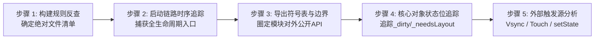
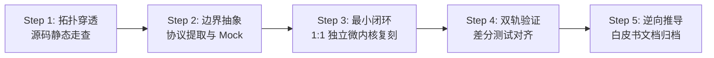
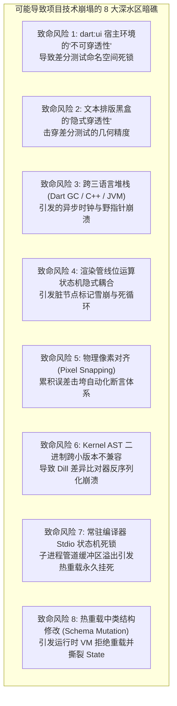

# Flutter 架构深度解构与 1:1 原理仿真工程总纲 (Master Blueprint)

> **工程定位**：`Flutter-Anatomy-Lab`（包含 `NanoFlutter` 运行时微内核仿真引擎与 `NanoCompiler` 编译构建工具链仿真引擎）  
> **核心目标**：以本地 `flutter_source` 为唯一客观真理基准，借鉴操作系统内核解构标准（`docs/Linux.md`），通过**“5 步地毯式闭环扫描”**、**“四层模拟器抽象”**、**“全域代码边界划定”**与**“孪生差分测试”**，在数月周期内彻底吃透 Flutter **“编译期静态编译/热重载 + 运行期渲染管线”** 端到端底层运作机制。  
> **技术路线**：方案 A（纯 Dart 逻辑微内核 + 现代 C++ 宿主桥接层 + 独立轻量构建编译器）。  
> **专项蓝图索引**：编译期专项总纲参见 [`docs/00_compile_time_master_plan.md`](./00_compile_time_master_plan.md)。

---

## 目录
1. [零遗漏证明：全域 MECE 黑白灰盒分级边界矩阵](#一-零遗漏证明全域-mece-黑白灰盒分级边界矩阵)
2. [Flutter 源码“5 步地毯式闭环审计法”（无死角扫描）](#二-flutter-源码5-步地毯式闭环审计法无死角扫描)
3. [全域十四大核心模块生命周期与接口契约矩阵 (Lifecycle & API Matrix)](#三-全域十四大核心模块生命周期与接口契约矩阵-lifecycle--api-matrix)
4. [全域十四大模块端到端源码文件穷尽清单 (Zero-Omission Manifest)](#四-全域十四大模块端到端源码文件穷尽清单-zero-omission-manifest)
5. [NanoFlutter + NanoCompiler 双引擎四层重构架构模型](#五-nanoflutter--nanocompiler-双引擎四层重构架构模型)
6. [单模块解构执行标准化流程（SOP）与验收标准（DoD）](#六-单模块解构执行标准化流程sop与验收标准dod)
7. [20 周全域多阶段长线工程全景路线图](#七-20-周全域多阶段长线工程全景路线图)
8. [全域核心技术风险与架构防范机制（Pre-mortem Analysis）](#八-全域核心技术风险与架构防范机制pre-mortem-analysis)

---

## 一、 零遗漏证明：全域 MECE 黑白灰盒分级边界矩阵

借鉴 Linux 内核解构思想，解构包含**“编译构建系统”**与**“运行时渲染引擎”**的复杂工业级框架，第一要务是建立**全域认知防波堤**，确保编译期编排转换与运行期核心管线白盒透彻，底层黑盒杂音严格黑盒隔离：

```mermaid
flowchart TD
    subgraph WhiteBox [⬜ 白盒核心层 (必须深入源码 1:1 独立原理复刻)]
        direction TB
        subgraph WB_Runtime [运行期微内核]
            W1[三棵树状态机: Widget/Element/RenderObject/State]
            W2[单次遍历盒约束管线: BoxConstraints/RelayoutBoundary]
            W3[图层树合成系统: LayerTree/RepaintBoundary]
            W4[输入拓扑与手势竞技场: HitTest/GestureArenaManager]
            W5[并发线程模型与消息泵: FML MessageLoop/TaskRunner]
        end
        subgraph WB_Compile [编译期工具链]
            WC1[构建编排有向无环图: BuildSystem / Target / Node DAG]
            WC2[文件级增量缓存判断: FileStore / Depfile .d 语法解析]
            WC3[常驻编译器交互状态机: ResidentCompiler Stdio 协议]
            WC4[Flutter 专有 AST 变换: TrackWidgetCreation 位置参数注入]
            WC5[字体字形树摇器: IconTreeShaker 扫描 AST 码位]
            WC6[热重载重塑通道: DevFS 增量同步 / reassemble 状态保留]
        end
    end

    subgraph GrayBox [🟨 灰盒协议层 (接口标准化、高效透传与 Stub 桩)]
        G1[C-ABI / Dart FFI 跨语言零拷贝桥接]
        G2[Android Choreographer 硬件帧脉冲捕捉]
        G3[SurfaceView / ANativeWindow 表面呈现]
        G4[MockCanvas / 矢量指令流记录器]
        G5[MockParagraph / 简易字符排版模型]
        GC1[Dart CFE Kernel AST 二进制协议 .dill]
        GC2[VM Service JSON-RPC 2.0 调试与重载通信协议]
        GC3[Impeller 离线着色器编译桥接: impellerc ShaderBundle]
        GC4[AOT 快照生成器桥接: gen_snapshot 4 大内存段格式]
        GC5[Native Assets 编译钩子协议: build.dart hook]
    end

    subgraph BlackBox [⬛ 黑盒底座层 (前期严格隔离，仅依赖标准运行环境)]
        B1[Dart VM 后端汇编器: SSA 中间表示优化 / 寄存器分配 / 机器码发射内部细节]
        B2[Skia/Impeller: GPU 驱动底层 / 贝塞尔三角剖分 / VBO 顶点缓冲]
        B3[HarfBuzz/ICU: 复杂文字塑形 / 连字匹配 / Unicode Bidi 底层算法]
        B4[Linux Kernel / 显卡芯片驱动 / EGL 驱动底层细节]
        BC1[平台原生构建打包器: Android AAPT2/D8/R8、Apple ld64/codesign、Xcode 内部流水线]
    end

    WhiteBox <==>|接口调用 / 指令通信| GrayBox
    GrayBox -. 驱动底座 .-> BlackBox
```

| 分级 | 涉及组件 | 隔离与处理策略 (How to isolate) | 预期收益 (Gain) |
| :--- | :--- | :--- | :--- |
| **黑盒** | `gen_snapshot` 机器指令发射内部细节、HarfBuzz 复杂排版底层、glslang 语法分析器、AAPT2/D8/R8 打包器、GPU EGL 交换链 | **严格当作外部工具黑盒**。调用官方 SDK 附带的预编译二进制或使用标准 Mock 脚本；输入产物与输出文件严格核验，不自研机器码汇编器与 GPU 驱动。 | 抽离 CPU 指令集架构与平台打包工具链杂音，聚焦渲染流水线、排版数学模型与构建编排增量核心。 |
| **灰盒** | C-ABI 导出层、Android Choreographer 脉冲、Kernel AST（.dill）协议、VM Service RPC、`impellerc` 参数规范、Native Assets hook | **定义标准最小协议与 Stub 桩**。跨语言以 C-ABI/FFI 直连；编译期协议基于标准化 JSON-RPC 与二进制结构封装，终端环境下由虚拟测试桩等价替换。 | 保证时钟对齐时序与编译器通信 100% 等价，消除通信环境依赖，实现毫秒级自动化闭环。 |
| **白盒** | FML 线程、渲染管线、单次遍历布局、三棵树 Diff、Layer 合成、手势竞技场、BuildSystem DAG、增量 FileStore、ResidentCompiler 状态机、Widget 坐标注入、Icon 树摇、DevFS 热重载 | **100% 深入源码逐行精读，并在 `nano_flutter` 与 `nano_compiler` 中用纯 Dart / C++ 进行 1:1 独立重写与测试断言。** | 彻底洞悉 Flutter 响应式声明式 UI、单次遍历不回流、局部重绘隔离、亚秒级热重载与生产态极致体积压缩的核心机密。 |

---

## 二、 Flutter 源码“5 步地毯式闭环审计法”（无死角扫描）

对标 `Linux.md` 第四节，为确保任何一个模块都不会出现“漏掉关键文件或隐蔽机制”，建立以下 5 维代码扫描审计法则：



### 步骤 1：基于构建文件拉取“绝对文件清单”
*   **方法**：
    *   Framework 侧：查阅 `packages/flutter/pubspec.yaml` 与各库的顶级导出文件（如 `packages/flutter/lib/rendering.dart` 中所有的 `export 'src/rendering/...';`），凡未被导出的内部实现文件逐一核验。
    *   Engine 侧：查阅 `engine/src/flutter/BUILD.gn` 与 `engine/src/flutter/shell/platform/android/BUILD.gn`，提取所有 `sources = [...]` 参与编译的 C++/Java 文件，杜绝漏掉受控特性。

### 步骤 2：启动时序串联法 (Initialization Tracing)
所有子模块的初始化入口，必沿主启动调用链被显式挂载，全程顺藤摸瓜：
1.  **Android 宿主启动**：`FlutterApplication` $\rightarrow$ `FlutterActivity.onCreate()` $\rightarrow$ 创建 `FlutterEngine`。
2.  **C++ 引擎与线程池就绪**：`FlutterJNI.init()` $\rightarrow$ `Shell::Create()` $\rightarrow$ 初始化 Platform/UI/Raster/IO 4 大 TaskRunner $\rightarrow$ 创建 `Animator` 与 `Engine` 实例。
3.  **Dart Isolate 诞生**：加载 `isolate_snapshot` $\rightarrow$ `DartExecutor.executeDartEntrypoint()` $\rightarrow$ 执行用户 `main()`。
4.  **Framework 绑定叠加**：`runApp()` 触发 `WidgetsFlutterBinding.ensureInitialized()`，沿 `BindingBase` 链式叠加：
    $$\text{BindingBase} \rightarrow \text{SchedulerBinding} \rightarrow \text{ServicesBinding} \rightarrow \text{PaintingBinding} \rightarrow \text{RendererBinding} \rightarrow \text{GestureBinding} \rightarrow \text{WidgetsBinding}$$
5.  **首帧驱动挂载**：`attachRootWidget()` 创建 `RenderView` 与 `RootElement` $\rightarrow$ 请求 Vsync $\rightarrow$ 首次 Pipeline 流水线运转。

### 步骤 3：跨层导出符号表审计 (Exported Symbols & Boundaries)
对标 Linux 的 `EXPORT_SYMBOL`，分析各层对外承诺暴露的 API 契约：
1.  **C++ 对 Dart 导出**：扫描 `engine/src/flutter/lib/ui/dart_ui.cc` 中的 `DART_REGISTER_NATIVE_STATIC` 注册表，这就是 `dart:ui` 的全部真面目（Canvas, PictureRecorder, SceneBuilder, Window）。
2.  **Java 对 C++ JNI 导出**：扫描 `platform_view_android_jni_impl.cc` 中的 `RegisterNatives`，圈定 Android 宿主调用 C++ 的边界。
3.  **Engine 对宿主 C-API 导出**：扫描 `engine/src/flutter/shell/platform/embedder/embedder.h`，这是官方标准嵌入 API。

### 步骤 4：核心数据结构的“状态标记血缘追踪” (Flags & Dirty Bitfields)
Flutter 的高性能局部刷新完全依赖核心对象的状态标记位。必须逐一追踪核心对象的所有布尔标志：
*   **`RenderObject` 的状态位**：
    *   `_needsLayout`：何时被设为 true？何时向上冒泡至 `_relayoutBoundary`？何时在 `performLayout()` 中被清空？
    *   `_needsPaint`：何时被设为 true？何时冒泡至 `isRepaintBoundary`？
    *   `_needsCompositingBitsUpdate`：图层提升标记。
*   **`Element` 的状态位**：
    *   `_dirty`：`setState()` 如何通过 `markNeedsBuild()` 将自身加入 `BuildOwner._dirtyElements` 并在 `rebuild()` 中重置。
    *   `_lifecycleState`（initial, active, inactive, defunct）。

### 步骤 5：外部中断与事件触发源驱动 (Trigger Ingress)
所有运行时动态触发的逻辑，入口仅有三类：
1.  **硬件时钟脉冲（被动触发）**：Android `Choreographer` $\rightarrow$ `VsyncWaiter` $\rightarrow$ `Window.onBeginFrame` $\rightarrow$ 动画与排版。
2.  **硬件触控输入（用户主动）**：Android `MotionEvent` $\rightarrow$ `PointerDataPacket` $\rightarrow$ `GestureBinding` $\rightarrow$ `HitTest` $\rightarrow$ 竞技场判定。
3.  **开发者状态突变（内部驱动）**：业务调用 `setState()` / 动画改变值 $\rightarrow$ 标记脏状态 $\rightarrow$ 注册 `scheduleFrame` $\rightarrow$ 等待下一轮 Vsync 触发。

---

## 三、 全域十四大核心模块生命周期与接口契约矩阵 (Lifecycle & API Matrix)

对标 `Linux.md` 第二、三节，清晰界定整个工程十四大核心模块（**运行期 8 大模块 + 编译期 6 大模块**）的生命周期契约、核心对象与对外暴露的 API（编译期完整推导详见 [`docs/00_compile_time_master_plan.md`](./00_compile_time_master_plan.md)）：

```mermaid
flowchart LR
    subgraph CompileDomain [编译构建域 (Compile-Time Toolchain)]
        C1[模块 C1: 构建编排与增量驱动]
        C2[模块 C2: Kernel 前端与 AST 变换]
        C3[模块 C3: 常驻守护与热重载重构]
        C4[模块 C4: AOT 快照与机器码生成]
        C5[模块 C5: 字体树摇与离线着色器]
        C6[模块 C6: 插件元编程与代码生成]
    end

    subgraph RuntimeDomain [运行渲染域 (Runtime Engine & Framework)]
        R1[模块 1: Android 宿主与 Channel]
        R2[模块 2: FML 线程与 Vsync 调度]
        R3[模块 3: 单次遍历盒排版内核]
        R4[模块 4: Flex 弹性盒与滚动视口]
        R5[模块 5: 响应式三棵树状态机]
        R6[模块 6: 图层树合成与重绘隔离]
        R7[模块 7: 输入路由与手势竞技场]
        R8[模块 8: 动画时钟驱动与物理场]
    end

    CompileDomain ==>|产物交付与增量更新| RuntimeDomain
```

| 模块编号与名称 | 初始化/挂载时机 (Lifecycle Entry) | 核心内部状态机与持有对象 | 对外核心 API 契约 (Exported APIs) | 销毁/回收时机 (Teardown/GC) |
| :--- | :--- | :--- | :--- | :--- |
| **模块 1：Android 宿主与 Channel 桥接** | `FlutterActivity.onCreate()`，Surface 创建时 | `FlutterJNI` (持有 `nativeShellHolder`)，`BinaryMessenger` 注册表 | `send()`, `setMessageHandler()`, `invokeMethod()`, `setMethodCallHandler()` | `Activity.onDestroy()`，JNI 解引 Native 堆对象 |
| **模块 2：FML 线程与 Vsync 帧调度** | `Shell::Create()`，`SchedulerBinding` 实例化 | `MessageLoop` 任务队列，`SchedulerPhase` 帧状态机 | `postTask()`, `postDelayedTask()`, `scheduleFrame()`, `scheduleTask()` | 引擎退出或 App 挂起时注销 Vsync 监听器 |
| **模块 3：单次遍历盒约束排版内核** | `RendererBinding.initInstances()`，树根挂载 | `BoxConstraints`, `PipelineOwner` 脏渲染节点链表 | `layout(constraints)`, `performLayout()`, `markNeedsLayout()`, `paint()` | `RenderObject.dispose()`，从渲染树卸载时 |
| **模块 4：弹性盒 Flex 与滚动切片** | 对应 Element 挂载，创建布局节点 | `ContainerParentDataMixin`（双向链表），`ScrollPosition` | `setupParentData()`, `computeDryLayout()`, `applyViewportDimension()` | 父节点销毁或视口虚拟化滑出可视区时回收 |
| **模块 5：响应式三棵树状态机** | `runApp()`，`attachRootWidget()` | `Element` 树形骨架，`BuildOwner._dirtyElements`，`State` | `createElement()`, `mount()`, `update()`, `canUpdate()`, `setState()` | `deactivate()` $\rightarrow$ 单帧结束未救回则 `unmount()` 触发 GC |
| **模块 6：图层树合成与重绘边界** | 首次 `flushPaint()`，创建 `PaintingContext` | `LayerTree` 拓扑树，`isRepaintBoundary` 独立图层容器 | `pushLayer()`, `addLayer()`, `SceneBuilder.build()`, `Window.render()` | 节点重绘时释放旧 `Picture` / 图层被整树替换时 |
| **模块 7：手势拓扑路由与竞技场** | 触摸事件到达，`GestureBinding` 分发 | `HitTestResult` 目标路径链，`GestureArenaManager` 投票池 | `handlePointerEvent()`, `hitTest()`, `add()`, `resolve()`, `accept()`, `reject()` | 手指抬起 `PointerUp`，竞技场清空胜出者后关闭 |
| **模块 8：时钟动画驱动与物理场** | 业务声明 Controller，绑定 `TickerProvider` | `AnimationController`（Dismissed, Forward, Reverse, Completed） | `forward()`, `reverse()`, `animateTo()`, `evaluate(Animation)`, `simulate()` | `AnimationController.dispose()`，Ticker 从时钟解绑 |
| **模块 C1：构建编排引擎与增量缓存驱动** | `flutter build/run` 命令初始化 `BuildSystem` | `Node` 拓扑图、`FileStore` 内存哈希表、`DepfileService` | `build(Target, Environment)`, `canSkip()`, `findInvalidated()` | 构建完毕将文件哈希持久化至磁盘 `.flutter-plugins-dependencies` |
| **模块 C2：Dart Kernel 前端编译与 AST 变换** | 首次执行 `KernelSnapshot` 构建任务 | `KernelCompiler`、`TargetModel`、AST 访问器状态 | `compile(mainPath, sdkRoot)`, AST 注入 `TrackWidgetCreation` | 生成根目录 `app.dill` 与符号依赖表，退出或驻留常驻池 |
| **模块 C3：增量编译守护、DevFS 与热重载** | `flutter run` 启动 `HotRunner` 并连接设备 | `ResidentCompiler` (Stdio 进程通道)、`DevFS` 追踪器 | `recompile()`, `accept()`, `reject()`, `reloadSources()`, `reassemble()` | 用户退出交互调试会话（`q`），杀死常驻编译器与清理 DevFS |
| **模块 C4：AOT 快照编译与多段二进制生成** | 执行 Profile/Release 模式的 `AotSnapshotBase` | `AOTSnapshotter`、`GenSnapshot` 参数生成器 | `build(platform, buildMode, dillPath, outputPath)` | 产出物理共享库 `app.so` / `App.framework`，剥离 DWARF 符号 |
| **模块 C5：资产多维树摇与离线着色器编译** | `CopyFlutterBundle` 与 `AssetBundle.build()` | `IconTreeShaker` (持有码位集)、`ShaderCompiler` (持有并发池) | `copyAssets()`, `compileShader()`, `subsetFont()` | 输出精简版 `MaterialIcons-Regular.otf` 与 `ShaderBundle` 字节流 |
| **模块 C6：插件自动注册元编程与 Native Assets** | `flutter pub get` 完成后或构建第一步 | `PackageConfig` 字典、Mustache 模板渲染器 | `generateMainDartWithPluginRegistrant()`, `BuildHooks.build()` | 生成 `.dart_tool/flutter_build/dart_plugin_registrant.dart` |

---

## 四、 全域十四大模块端到端源码文件穷尽清单 (Zero-Omission Manifest)

源码基准绝对路径：`/Volumes/MacBookData/workspace/flutter-anatomy/flutter_source/flutter`

### 运行期微内核体系 (模块 1 ~ 模块 8)

### 模块 1：Android 宿主嵌入层与跨语言双向通讯底座
*   **Android 宿主 (Java)** (`engine/src/flutter/shell/platform/android/io/flutter/`):
    *   `embedding/android/FlutterActivity.java` —— 官方 Activity 宿主基类
    *   `embedding/android/FlutterView.java` —— 承载 Flutter 内容的 Android ViewGroup
    *   `embedding/android/FlutterSurfaceView.java` —— 硬件加速 Surface 渲染载体
    *   `embedding/android/FlutterTextureView.java` —— 纹理视图渲染载体
    *   `embedding/android/FlutterActivityAndFragmentDelegate.java` —— 宿主生命周期代理中枢
    *   `embedding/engine/FlutterEngine.java` —— Android 侧引擎门面对象
    *   `embedding/engine/FlutterJNI.java` —— Java 跨 JNI 调用 C++ 的唯一底层通道
    *   `embedding/engine/dart/DartExecutor.java` —— Dart 入口代码触发器
    *   `embedding/engine/renderer/FlutterRenderer.java` —— 渲染回调与视口尺寸同步
    *   `plugin/common/BinaryMessenger.java` —— 字节流通信接口
    *   `plugin/common/MethodChannel.java` —— RPC 风格方法调用抽象
    *   `plugin/common/BasicMessageChannel.java` —— 基础消息通道
    *   `plugin/common/StandardMessageCodec.java` —— 高性能二进制序列化编解码器
    *   `plugin/platform/PlatformViewsController.java` —— 原生 View 混合渲染管理中枢
*   **C++ 引擎桥接** (`engine/src/flutter/shell/platform/android/`):
    *   `platform_view_android.h / .cc` —— C++ 平台视图代理，接收 Android 宿主指令
    *   `platform_view_android_jni_impl.h / .cc` —— 9 万行核心 JNI 方法注册与映射实现
    *   `platform_message_handler_android.h / .cc` —— C++ 消息分发处理器
    *   `platform_message_response_android.h / .cc` —— 跨语言消息异步响应封装
    *   `android_surface_gl_skia.h / .cc` —— OpenGL ES 表面环境绑定
    *   `android_surface_gl_impeller.h / .cc` —— Impeller 现代表面绑定
    *   `library_loader.cc` —— `JNI_OnLoad` 入口与符号表加载
*   **Dart 通信层** (`packages/flutter/lib/src/services/`):
    *   `binding.dart`, `binary_messenger.dart`, `platform_channel.dart`, `message_codecs.dart`, `platform_views.dart`, `system_channels.dart`

### 模块 2：FML 并发线程模型与硬件 Vsync 帧调度心跳
*   **C++ 线程与调度** (`engine/src/flutter/fml/` 及 `engine/src/flutter/shell/`):
    *   `fml/message_loop.h / .cc`, `fml/message_loop_impl.h / .cc` —— 消息循环底层实现
    *   `fml/task_runner.h / .cc` —— 线程任务投递器（`PostTask`, `PostDelayedTask`）
    *   `fml/thread.h / .cc` —— 物理线程封装
    *   `fml/delayed_task.h / .cc` —— 最小堆优先级的延迟任务队列
    *   `fml/synchronization/waitable_event.h / .cc`, `fml/time/time_point.h / .cc`
    *   `shell/common/animator.h / .cc` —— 帧生产与光栅消费两阶段协调器
    *   `shell/common/engine.h / .cc`, `shell/common/vsync_waiter.h / .cc`
    *   `shell/platform/android/vsync_waiter_android.h / .cc` —— Android Choreographer JNI 桥接
    *   `shell/platform/android/io/flutter/view/VsyncWaiter.java` —— Java 层捕获 Choreographer 脉冲
*   **dart:ui 跨语言钩子** (`engine/src/flutter/lib/ui/`):
    *   `window.dart` —— `PlatformDispatcher` 宿主接口
    *   `hooks.dart` —— C++ 唤醒 Dart 的底层入口（`_onBeginFrame`, `_onDrawFrame`, `_scheduleMicrotask`）
*   **Dart 帧调度** (`packages/flutter/lib/src/scheduler/` 及 `foundation/`):
    *   `scheduler/binding.dart` —— 管理帧五阶段（`idle` $\rightarrow$ `transient` $\rightarrow$ `midMicrotasks` $\rightarrow$ `persistent` $\rightarrow$ `postFrame`）
    *   `scheduler/ticker.dart`, `scheduler/priority.dart`
    *   `foundation/binding.dart` (BindingBase), `foundation/change_notifier.dart`, `foundation/node.dart`

### 模块 3：极简单次遍历盒约束排版与渲染管线微内核
*   **Dart 渲染核心** (`packages/flutter/lib/src/rendering/`):
    *   `binding.dart` (RendererBinding)
    *   `pipeline_owner.dart` (flushLayout, flushCompositingBits, flushPaint)
    *   `object.dart` (RenderObject, RelayoutBoundary)
    *   `box.dart` (RenderBox, BoxConstraints)
    *   `view.dart` (RenderView)
    *   `shifted_box.dart` (RenderPadding, RenderPositionedBox)
    *   `proxy_box.dart` (RenderCustomPaint, RenderRepaintBoundary)
*   **几何基础** (`packages/flutter/lib/src/painting/`):
    *   `basic_types.dart` (Size, Offset, Rect), `matrix_utils.dart`, `edge_insets.dart`, `alignment.dart`

### 模块 4：弹性盒 Flex 模型、多子容器与滚动视口架构
*   **复杂容器排版** (`packages/flutter/lib/src/rendering/`):
    *   `flex.dart` (RenderFlex: Row/Column 主轴交叉轴两轮空间分配算法)
    *   `stack.dart` (RenderStack, Positioned 重叠布局)
    *   `wrap.dart`, `table.dart`, `custom_layout.dart`
*   **虚拟化滚动体系** (`packages/flutter/lib/src/rendering/`):
    *   `viewport.dart` (RenderViewport)
    *   `viewport_offset.dart` (ViewportOffset)
    *   `sliver.dart`, `sliver_list.dart`, `sliver_grid.dart`, `sliver_padding.dart`

### 模块 5：响应式三棵树状态机与 Reconciliation 核心
*   **核心状态机** (`packages/flutter/lib/src/widgets/`):
    *   `framework.dart` —— Widget, Element, State, BuildOwner, InheritedElement, InheritedWidget
    *   `binding.dart` (WidgetsBinding, runApp)
*   **基础组件** (`packages/flutter/lib/src/widgets/`):
    *   `basic.dart` (Padding, Center, Row, Column, Stack)
    *   `container.dart`, `text.dart`, `image.dart`
    *   `inherited_theme.dart`, `navigator.dart`, `overlay.dart`

### 模块 6：图层树合成、RepaintBoundary 缓存与光栅管线
*   **Dart 绘制图层** (`packages/flutter/lib/src/rendering/` 及 `painting/`):
    *   `rendering/layer.dart` (Layer, ContainerLayer, OffsetLayer, ClipRectLayer, PictureLayer)
    *   `rendering/object.dart` (PaintingContext)
    *   `painting/canvas.dart`, `painting/paint.dart`, `painting/picture.dart`
*   **dart:ui 原生接口** (`engine/src/flutter/lib/ui/`):
    *   `painting.dart`, `compositing.dart` (SceneBuilder, Scene)
*   **C++ Flow 引擎** (`engine/src/flutter/flow/` 及 `display_list/`):
    *   `flow/layer_tree.h / .cc`, `flow/layers/layer.h / .cc`, `flow/raster_cache.h / .cc`
    *   `display_list/display_list.h / .cc`, `display_list/dl_canvas.h / .cc`, `shell/common/rasterizer.h / .cc`

### 模块 7：输入事件拓扑路由与手势竞技场仲裁系统
*   **Android 输入拦截** (`engine/src/flutter/shell/platform/android/io/flutter/embedding/android/`):
    *   `AndroidTouchProcessor.java`, `MotionEventTracker.java`
*   **C++ & dart:ui 打包** (`engine/src/flutter/lib/ui/`):
    *   `pointer.dart` (PointerDataPacket, PointerData)
*   **Dart 手势框架** (`packages/flutter/lib/src/gestures/`):
    *   `binding.dart` (GestureBinding), `arena.dart` (GestureArenaManager)
    *   `recognizer.dart` (GestureRecognizer), `tap.dart`, `drag.dart`, `scale.dart`
    *   `hit_test.dart` (HitTestTarget, HitTestResult)
*   **组件响应绑定** (`packages/flutter/lib/src/widgets/` 及 `rendering/`):
    *   `rendering/box.dart` (hitTest, hitTestChildren)
    *   `widgets/gesture_detector.dart` (GestureDetector)

### 模块 8：时钟驱动动画、缓动曲线与物理仿真系统
*   **Dart 动画与物理** (`packages/flutter/lib/src/animation/` 及 `physics/`):
    *   `animation/animation.dart`, `animation/animation_controller.dart`
    *   `animation/curves.dart` (Cubic 贝塞尔曲线), `animation/tween.dart`
    *   `physics/simulation.dart`, `physics/spring_simulation.dart`, `physics/friction_simulation.dart`
*   **动画组件绑定** (`packages/flutter/lib/src/widgets/`):
    *   `animated_builder.dart`, `implicit_animations.dart`, `transitions.dart`

---

### 编译期工具链体系 (模块 C1 ~ 模块 C6)
*(详细代码走查与专项分析参见 [`docs/00_compile_time_master_plan.md`](./00_compile_time_master_plan.md))*

### 模块 C1：构建编排引擎与 DAG 增量缓存机制 (BLD)
*   **构建编排核心** (`packages/flutter_tools/lib/src/build_system/`):
    *   `build_system.dart` —— `BuildSystem` 调度中枢、`Target` 抽象基类、`Environment` 构建上下文
    *   `build_targets.dart` —— 构建目标字典与默认目标集合
    *   `file_store.dart` —— 文件内容散列比对器与增量指纹持久化引擎
    *   `depfile.dart` —— Makefile 格式依赖描述文件解析器与生成器
    *   `source.dart` —— 灵活声明输入输出的 `Source` 抽象（模式匹配、环境变量求值、工件引用）
    *   `hash.dart` —— 高性能文件流 SHA-256 增量哈希计算
    *   `exceptions.dart` —— 构建阶段异常定义（MissingDefineException, CircularDependencyException）
*   **通用构建目标** (`packages/flutter_tools/lib/src/build_system/targets/`):
    *   `common.dart` —— `KernelSnapshot`、`AotSnapshotBase`、`CopyFlutterBundle` 基础目标定义

### 模块 C2：Dart Kernel 前端编译与 AST 专项变换 (KRN)
*   **编译器前端调用桥接** (`packages/flutter_tools/lib/src/`):
    *   `compile.dart` —— `KernelCompiler`、`ResidentCompiler`、`DefaultResidentCompiler`、`TargetModel`
    *   `artifacts.dart` —— 编译器预编译工件路径寻址器（`frontend_server.dart.snapshot`、`patched_sdk`）
    *   `build_info.dart` —— `BuildMode`（debug/profile/release）、编译选项解构
*   **引擎侧前端编译器接入** (`engine/src/flutter/flutter_frontend_server/`):
    *   `BUILD.gn`, `pubspec.yaml`
*   **AST 变换规范**:
    *   `TrackWidgetCreation` 构造器行号列号注桩规范（注入 `$creationLocation` 字段）
    *   `ConstCanonicalization` 跨文件不可变对象合并机制

### 模块 C3：增量编译守护、DevFS 传输与热重载重构 (HOT)
*   **常驻运行中枢** (`packages/flutter_tools/lib/src/`):
    *   `run_hot.dart` —— `HotRunner`、`_reloadSources`、`_hotReloadHelper`、状态防抖与耗时度量
    *   `resident_runner.dart` —— 交互式命令行键盘事件分发器（`r` / `R` / `q`）
    *   `devfs.dart` —— 内存虚拟文件系统、文件内容差分提取、增量字节流序列化
    *   `vmservice.dart` —— Dart VM Service JSON-RPC 客户端封装、隔离区（Isolate）重载驱动
*   **运行时状态无损协同** (`packages/flutter/lib/src/widgets/`):
    *   `framework.dart` —— `Element.reassemble()` 遍历标记全部节点脏状态并保留 `State`

### 模块 C4：生产态 AOT 快照编译与多段二进制生成 (AOT)
*   **快照构建器驱动** (`packages/flutter_tools/lib/src/base/` 及 `build_system/targets/`):
    *   `build.dart` —— `AOTSnapshotter`、`GenSnapshot` 物理参数组装（`--snapshot-kind=app-aot-elf`）
    *   `targets/common.dart` —— `AotSnapshotProfile`、`AotSnapshotRelease` 目标声明
    *   `targets/android.dart` —— Android 平台生成 `libapp.so`
    *   `targets/darwin.dart` / `ios.dart` —— Apple 平台生成 `App.framework`
*   **引擎底层快照映射** (`engine/src/flutter/runtime/`):
    *   `dart_snapshot.h / .cc` —— 映射 ELF 段到 `vm_snapshot_data`、`vm_snapshot_instr`、`isolate_snapshot_data`、`isolate_snapshot_instr`
    *   `dart_vm.cc` —— 接收 4 大内存段初始化 Dart 虚拟机堆空间

### 模块 C5：资产多维树摇与离线着色器编译 (SHK)
*   **字体字形裁剪体系** (`packages/flutter_tools/lib/src/build_system/targets/` 及 `engine/`):
    *   `targets/icon_tree_shaker.dart` —— 解析 `recorded_uses.json`，调度 `font-subset` 物理裁剪
    *   `engine/src/flutter/tools/font_subset/main.cc` —— C++ 基于 HarfBuzz 的字形裁剪命令行工具
    *   `engine/src/flutter/tools/font_subset/hb_wrappers.h` —— HarfBuzz 字体封装
*   **Impeller 离线着色器流水线** (`packages/flutter_tools/lib/src/build_system/tools/` 及 `engine/`):
    *   `tools/shader_compiler.dart` —— `ShaderCompiler`、`DevelopmentShaderCompiler`（开发态着色器热重载）
    *   `engine/src/flutter/impeller/compiler/impellerc_main.cc` —— 离线着色器编译器入口
    *   `engine/src/flutter/impeller/compiler/compiler.cc` —— GLSL 转换为 SPIR-V / MSL
    *   `engine/src/flutter/impeller/compiler/shader_bundle.cc` —— 离线打包为多后端 `ShaderBundle`
*   **通用资产打包** (`packages/flutter_tools/lib/src/`):
    *   `asset.dart` —— `AssetBundle`、`AssetManifest.bin` 紧凑二进制格式序列化
    *   `build_system/targets/assets.dart` —— `copyAssets` 构建目标实现

### 模块 C6：插件自动注册元编程与 Native Assets (GEN)
*   **插件路由静态合成** (`packages/flutter_tools/lib/src/build_system/targets/`):
    *   `targets/dart_plugin_registrant.dart` —— `DartPluginRegistrantTarget` 目标驱动
    *   `flutter_plugins.dart` —— 解析 `pubspec.yaml` 插件映射，生成 `dart_plugin_registrant.dart`
*   **Native Assets 静态绑定** (`packages/flutter_tools/lib/src/build_system/targets/` 及 `isolated/`):
    *   `targets/native_assets.dart` —— `BuildHooks` 目标，驱动执行各 package 根目录下的 `build.dart`
    *   `isolated/native_assets/native_assets.dart` —— C/C++ FFI 源码编译与产物链接

---

## 五、 NanoFlutter + NanoCompiler 双引擎四层重构架构模型

对标 `Linux.md` 第一节中模拟器的四层模型，工程建立涵盖**运行期渲染微内核 (`NanoFlutter`)**与**编译期构建工具链 (`NanoCompiler`)**的统一纯用户态仿真沙盒：

```
+----------------------------------------------------------------------------------------------------+
| 4. 驱动、观测与差分测试层 (Test Harness, Tree Dumper, AST Inspector, Diff Inspector)              |
|    - 运行时差分器: 比对官方与 NanoFlutter 的 Size / Offset / Layer / HitTest                       |
|    - 编译期差分器: 比对官方 dill 与 NanoCompiler 的 AST 节点、符号表与 DAG 拓扑执行序             |
|    - 终端双模可视化: ASCII 布局树导出器 + DAG 依赖图导出器                                         |
+----------------------------------------------------------------------------------------------------+
| 3. 业务状态机、元编程与三棵树层 (NanoWidgets & NanoElements & NanoCodegen)                        |
|    - 运行时状态机: Widget 声明式 DSL / Element 树形骨架持有与 canUpdate() / BuildOwner 批量脏重构  |
|    - 编译期元编程: TrackWidgetCreation AST 物理坐标注入器 / DartPluginRegistrant 代码合成器         |
+----------------------------------------------------------------------------------------------------+
| 2. 核心算法与编排流水线层 (NanoRendering, NanoScheduler & NanoBuildSystem, NanoDevFS)             |
|    - 渲染算法: BoxConstraints 单次遍历排版 / RelayoutBoundary 隔离 / PaintingContext 合成 / 手势竞技|
|    - 编译算法: NanoBuildSystem DAG 拓扑排序 / NanoFileStore SHA-256 指纹 / Depfile 解析 / DevFS 差分|
|    - 热重载协调: ResidentCompiler Stdio 状态机 / VM Service reloadSources 触发 / reassemble 状态保留 |
+----------------------------------------------------------------------------------------------------+
| 1. 虚拟硬件、编译器协议与宿主环境 Mock 层 (Virtual Hardware, Host & Subprocess Mock)              |
|    - 硬件时钟: VirtualVsync (高精度纳秒定时器或 Android Choreographer 桥接)                        |
|    - 绘图抽象: MockCanvas (矢量绘图指令流记录器) / MockParagraph (等宽字符盒模型)                 |
|    - 编译器桩: MockFrontendServer (Stdio 模拟器) / MockImpellerc (伪着色器包) / MockFontSubsetter |
|    - 虚拟环境: VirtualFileSystem (纯内存文件系统) / FakePointerStream (离散触控生成器)             |
+----------------------------------------------------------------------------------------------------+
```

---

## 六、 单模块解构执行标准化流程（SOP）与验收标准（DoD）

为确保后续逐个攻坚模块时不跑偏、不降质，规定所有模块必须**严格遵循以下 5 步 SOP**，并满足**四大验收维度（DoD）**：



### 1. 标准执行五步法（SOP）
*   **Step 1：拓扑穿透与静态走查（Code Anatomy）**
    *   圈定清单内文件，绘制模块架构图、类继承关系图与调用时序图。
    *   明确模块的**三要素**：谁调用它（Entry）、它持有改变什么状态（State）、它向谁递交产物（Exit）。
*   **Step 2：协议接口抽象与黑盒 Mock（Protocol & Mocking）**
    *   将该模块依赖的底层/外部系统抽离为强类型接口。
    *   编写下层 Mock 桩（如用 `MockCanvas` 模拟 Skia，用 `VirtualVsync` 模拟硬件脉冲）。
*   **Step 3：1:1 原理级独立微内核代码复刻（1:1 Minimal Reproduction）**
    *   在 `nano_flutter` 中独立编写复刻代码。
    *   **命名完全对齐**：核心类名、关键状态变量与核心函数（如 `performLayout`, `markNeedsLayout`, `canUpdate`）必须与官方源码保持一致。
    *   **剔除杂质**：坚决剥离性能监控打点、历史遗留兼容垫片与平台差异补丁。
*   **Step 4：双轨测试与官方孪生差分对齐（Differential Testing）**
    *   编写纯 Dart 终端单测，覆盖正常流、极限边界流与异常阻断流。
    *   构建同一结构树输入官方 Flutter 与 NanoFlutter，做几何数值与拓扑比对。
*   **Step 5：逆向架构推导与原理白皮书归档（Reverse-Engineering Docs）**
    *   在 `docs/principles/` 产出高质量分析文档，核心回答 **“Why Flutter does this?”**。

### 2. 最终验收标准 (Definition of Done - DoD)
任何一个模块在宣告“解构完成”前，必须同时通过以下**四大硬性指标**的严格审查：

```
┌────────────────────────────────────────────────────────────────────────┐
│                        模块解构验收标准 (DoD)                           │
├────────────────────┬───────────────────────────────────────────────────┤
│ 1. 代码复刻度验收  │ • 零第三方框架依赖（仅允许纯 Dart 与基础 C++）       │
│    (Code Fidelity) │ • 核心状态机与官方源码逻辑 1:1 等价                │
│                    │ • 无未处理的死循环、内存悬挂或并发死锁风险         │
├────────────────────┼───────────────────────────────────────────────────┤
│ 2. 测试与差分验收  │ • 单元测试覆盖率 > 90% (含边界条件测试)            │
│    (Testing DoD)   │ • 差分测试断言误差: |Official - Nano| <= 0.001px  │
│                    │ • 命中测试链表 / 手势胜出者 100% 对齐              │
├────────────────────┼───────────────────────────────────────────────────┤
│ 3. 观测与自省验收  │ • 具备可直接在终端 Dump 完整状态树的能力            │
│    (Observability) │ • 能清晰观察到 Dirty 标记冒泡阻断的全过程          │
├────────────────────┼───────────────────────────────────────────────────┤
│ 4. 原理白皮书验收  │ • 包含标准 Mermaid 时序图与类关系图               │
│    (Documentation) │ • 包含核心设计决策推导（Why 替代 What）            │
│                    │ • 包含如果不这么设计引发的灾难反证实验总结         │
└────────────────────┴───────────────────────────────────────────────────┘
```

---

## 七、 20 周全域多阶段长线工程全景路线图

将**运行期微内核仿真（Line A~D）**与**编译构建工具链仿真（Line E）**深度交织，建立端到端协同演进的多阶段工程路线图：

| 阶段 | 周期 | 运行期攻坚模块 | 编译期攻坚模块 | 核心交付物与里程碑门禁 (Exit Criteria) |
| :--- | :--- | :--- | :--- | :--- |
| **阶段一** | 第 1~3 周 | **模块 1 & 模块 2**<br>(宿主通讯 / FML 线程 / Vsync) | **模块 C1**<br>(构建编排 / DAG 拓扑 / Depfile 增量) | • 终端跑通 60/120Hz Vsync 脉冲派发，跨语言时钟对齐<br>• `NanoBuildSystem` 解析依赖 DAG，实现 Makefile .d 增量缓存<br>• 门禁：时钟单调递增，未变动目标 100% 命中 `canSkip`。 |
| **阶段二** | 第 4~6 周 | **模块 3**<br>(盒约束单次布局微内核) | **模块 C2**<br>(Dart Kernel 前端 / AST 变换) | • `RenderBox` / `BoxConstraints` 单次遍历算法库<br>• `TrackWidgetCreation` 注入 Widget 构造函数物理坐标<br>• 门禁：终端输出 ASCII 布局树；AST 注桩位置与官方 100% 对齐。 |
| **阶段三** | 第 7~10 周 | **模块 5**<br>(响应式三棵树状态机) | **模块 C3**<br>(常驻编译器 / DevFS / 热重载) | • `Widget/Element/RenderObject` 三重解耦与 Diff<br>• `ResidentCompiler` Stdio 状态机与 DevFS 差分同步<br>• 门禁：动态增删节点 Diff 行为对齐；热重载触发 UI `reassemble` 且 `State` 无损保持。 |
| **阶段四** | 第 11~14 周 | **模块 4 & 6 & 7**<br>(Flex/图层合成/手势竞技) | **模块 C5**<br>(字体树摇 / Impeller 离线着色) | • Flex 两轮切分、`LayerTree` 合成与 `RepaintBoundary`<br>• `IconTreeShaker` 提取码位，`ShaderCompiler` 编译<br>• 门禁：手势仲裁胜负严格对齐；字体裁剪率 > 90%，着色器离线打包。 |
| **阶段五** | 第 15~18 周 | **模块 8 & Android 宿主**<br>(动画物理场 / 真机闭环) | **模块 C4 & 模块 C6**<br>(AOT 快照生成 / Native Assets) | • 极简 Android Native APK 宿主，SurfaceView 真实显示<br>• `AOTSnapshotter` 组装参数，解析 4 大内存段；生成插件路由<br>• 门禁：在真机上流畅运行纯自研微内核交互界面；AOT 符号解析无误。 |
| **阶段六** | 第 19~20 周 | **全域双轨差分收敛**<br>(孪生比对 / 白皮书总结) | **编译期全链路闭环**<br>(端到端包体输出 / 结项) | • 《Flutter 底层架构与编译期解构白皮书》全套（共 14 篇）<br>• 全量 50+ 个原子功能点双轨差分测试报告<br>• 门禁：NanoCompiler 编排出的产物在 NanoFlutter 上工业级对齐呈现。 |

---

## 八、 全域核心技术风险与架构防范机制（Pre-mortem Analysis）

纯粹从底层架构与软件工程的技术维度审视，本工程在实施过程中存在以下 **8 大核心致命技术风险（5 个运行时风险 + 3 个编译期风险）**。必须在前期顶层设计中建立前置防范机制，杜绝中途返工：



### 1. 致命风险 1：`dart:ui` 伪装库的“不可穿透性”，导致孪生差分测试陷入命名空间死锁
*   **风险机理**：
    `dart:ui` 是官方在 C++ Engine 的 Dart VM 启动时通过 `Dart_SetLibraryTagHandler` 强行注入内部上下文的“假库”。在标准 Dart 命令行（`dart test`）中直接 `import 'dart:ui'` 会报编译错误。若 `NanoFlutter` 使用自己的 `nano_ui`，两者的类定义天然不通，同一套 Widget DSL 无法直接喂给双端编译。
*   **架构防范方案**：
    1.  **AST 源码映射层**：利用 Dart 官方 `analyzer` 工具，在差分测试加载用例时，动态将 `dart:ui` 命名空间重定向映射至 `nano_ui`。
    2.  **接口阴影层（Interface Shadowing）**：RenderObject 统一面向抽象画板接口编程，切断对具体原生宿主库的强依赖。

### 2. 致命风险 2：文本排版黑盒的“隐式穿透”，击穿单次排版的几何收敛
*   **风险机理**：
    文本排版并非纯黑盒。`RenderParagraph` 深度依赖基线对齐（`TextBaseline.alphabetic`）、固有尺寸测算（`IntrinsicHeight`）以及内联组件嵌入（`WidgetSpan` 的双向递归布局）。Mock 层一旦与官方产生 $1\text{px}$ 误差，就会在 `Flex` 空间切分中引发蝴蝶效应，导致差分测试大面积漂移。
*   **架构防范方案**：
    *   **排版桩数据录制（Golden Layout Recording）**：对特定文本输入的宽高、基线位置进行快照录制。差分测试时，Mock 层直接重放录制数据，彻底抹平字体引擎底层差异。

### 3. 致命风险 3：跨三语言堆栈（Dart GC / C++ 堆 / JVM）的时钟抖动与对象虚悬
*   **风险机理**：
    系统横跨 Android JVM（ART GC）、C++ Native（智能指针/无GC）与 Dart Isolate（分代GC）。若 C++ 触发的 Vsync 脉冲在 Dart 执行微任务排空的间隙强行打断，会导致 `setState()` 状态丢失；若 Dart 对象已被 GC 回收而 C++ TaskRunner 异步任务仍持有其裸指针，会引发不可逆的 `SIGSEGV` 闪退。
*   **架构防范方案**：
    *   **严格 Handle ID 代理机制**：跨语言禁止传递裸指针，统一使用 64 位整型 Handle ID 寻址，C++ 侧维护安全的弱引用 Handle 表。
    *   **微任务清空屏障（Drain Barrier）**：在 Vsync 帧阶段推进前，强制排空 Dart 微任务队列。

### 4. 致命风险 4：渲染管线位运算状态机的隐式耦合（图层提升与重排边界）
*   **风险机理**：
    `_needsLayout`、`_needsPaint`、`_needsCompositingBitsUpdate` 与 `relayoutBoundary` 之间存在紧密的位运算联动。当深层子节点新增透明度或剪裁导致图层提升时，`needsCompositing` 必须向上传递并强行重构父级绘制流向。若状态位冒泡阻断逻辑错漏一行，会导致过度重绘灾难或脏状态饿死（界面不刷新）。
*   **架构防范方案**：
    *   **形式化状态迁移探针**：在关键节点植入强断言 `assert(!parent._needsLayout)` 与 `assert(_lifecycleState == clean)`，对所有状态位转移进行防御性自检。

### 5. 致命风险 5：子像素对齐（Pixel Snapping）与浮点累积误差击垮自动化断言
*   **风险机理**：
    逻辑坐标是 `double` 浮点数，物理屏幕是离散整数。官方为防止模糊引入了像素吸附算法：`snapped = round(logical * ratio) / ratio`。若自研微内核未精确复刻吸附规则，在深层嵌套下浮点微差会被逐级放大，导致差分断言（$\le 0.001\text{px}$）疯狂误报，使测试套件失效。
*   **架构防范方案**：
    *   **统一精度归一化工具（MathSnapping Layer）**：1:1 提取官方 `matrix_utils.dart` 浮点数比较与物理吸附方法，所有几何测算强制走统一归一化截断。

### 6. 致命风险 6：Kernel AST 二进制格式跨小版本的破坏性不兼容
*   **风险机理**：
    Dart Kernel AST（`.dill`）不是长期稳定的文件格式，其二进制 Tag 编码随 Dart SDK 小版本升级而变动。若直接用二进制字节比对官方与自研产物，即使语义 100% 一致，也会因格式版本微差导致差分测试大面积红斑崩溃。
*   **架构防范方案**：
    *   **锁定统一 SDK 基准**：全局强制绑定 `./flutter_source/flutter/bin/dart`，禁止使用宿主系统的任意第三方 Dart 版本。
    *   **语义树差异比对 (AST Semantic Diff)**：差分比对不对比原始二进制流，而是将 `.dill` 转换为人类可读的 AST 文本表示，针对类名、字段名、方法体指令序列进行语义级等价断言。

### 7. 致命风险 7：常驻编译器 Stdio 文本交互状态机死锁与管道阻塞
*   **风险机理**：
    `DefaultResidentCompiler` 与 `frontend_server` 通过 stdin/stdout 进行长连接双向通信。如果某条编译报错输出超出操作系统管道缓冲区且没有及时异步消费，或者前端由于语法错误未吐出预期的结束符，主进程会陷入永久 `await` 死锁。
*   **架构防范方案**：
    *   **非阻塞双工流缓冲区封装**：以行（LineSplitter）为单位消费标准输出，所有响应设置严格的看门狗超时（Watchdog Timeout, 10 秒超时强杀并报错）。
    *   **明确错误状态转移**：收到前端报错时，状态机必须强行迁移至 `rejected` 状态并执行通道清空（Drain），杜绝残存脏数据污染下一轮交互。

### 8. 致命风险 8：热重载类结构修改引发 VM 拒绝与状态撕裂
*   **风险机理**：
    Flutter 热重载禁止给已有类增删字段、修改类继承关系或修改枚举。若开发者修改了类结构，Dart VM Service 会抛出 `kIsolateReloadBarred` 异常。若系统未正确识别该异常，强行派发 `reassemble()`，会导致新旧对象内存布局不匹配，引发原生 `SIGSEGV` 闪退。
*   **架构防范方案**：
    *   **Schema 预检与降级保护**：在触发 `reloadSources` 前，差分扫描类定义元数据；若检测到字段变动，主动拦截热重载并向开发者提示必须执行热重启（Hot Restart, `R`）。
    *   **状态保留原子回滚**：如果 VM 报错，立即向编译器发送 `reject` 指令回滚编译器内部状态，保持运行时旧代码与内存状态的完整性。


