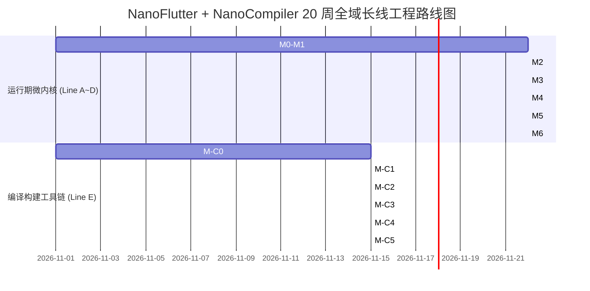

# Flutter 深度解构与 1:1 原理仿真迭代计划（ROADMAP v1）

> **输入规格**：[`01-feature-set.md`](./01-feature-set.md)（70+ 个原子功能 ID，涵盖运行期与编译期）+ [`02-test-inventory.md`](./02-test-inventory.md)（官方测试实名核对清单）  
> **方法论**：Superpowers TDD + 孪生差分比对，行为切片先写测试，阶段交付端到端闭环验证  
> **项目代号**：`NanoFlutter` + `NanoCompiler`（纯 Dart 逻辑微内核 + 现代 C++ 宿主桥接 + 轻量独立编译器）  
> **文档索引**：[`00_master_plan_and_methodology.md`](./00_master_plan_and_methodology.md) | [`00_compile_time_master_plan.md`](./00_compile_time_master_plan.md) | **上游**：[`01-feature-set.md`](./01-feature-set.md)、[`02-test-inventory.md`](./02-test-inventory.md)

---

## 0. 目标与兼容性边界

### 0.1 五条交付线

| 交付线 | 覆盖里程碑 | 可交付独立能力 | 不要求同步完成 |
|---|---|---|---|
| **A：Headless 渲染管线微内核** | M0–M2 | 纯 Dart 终端命令行；盒约束计算、单次遍历布局、RelayoutBoundary 阻断、ASCII/SVG 布局导出 | 三棵树、GPU 渲染、手势交互 |
| **B：响应式状态机与三棵树** | M3 | 纯 Dart 运行器；`Widget/Element/RenderObject` 解耦、`canUpdate` Diff 算法、批量 `setState` 刷新机制 | 真实手势、原生平台桥接 |
| **C：图层合成与交互竞技场** | M4–M5 | 纯 Dart 运行器；`LayerTree` 合成、`RepaintBoundary` 绘制隔离、手势竞技场仲裁、时钟驱动动画物理场 | Android 原生窗口呈现 |
| **D：Android 宿主与原生呈现** | M6 | Android 原生 APK；C++ FML 消息循环、`Choreographer` Vsync JNI、`SurfaceView` 真实屏幕显示、PlatformView | 多平台支持（iOS/Web/Desktop 暂不涉及） |
| **E：编译构建与热重载工具链** | M-C0–M-C5 | 纯 Dart 终端命令行；DAG 拓扑编排、FileStore 哈希指纹、Depfile 增量解析、TrackWidgetCreation 注桩、ResidentCompiler Stdio 状态机、DevFS 差分传输、AOT 4 大内存段解析、Icon 树摇 | 平台原生打包器（AAPT2/Xcode）内部细节 |

**首个关键交付物是 Line A（极简渲染管道内核）与 Line E（DAG 构建编排引擎），均在纯 Dart 终端无头环境下以毫秒级完成。**

### 0.2 固定兼容性矩阵

| 维度 | 本迭代版固定选择 | 说明 |
|---|---|---|
| **官方源码基准** | 本地 `flutter_source/flutter` 快照 | 唯一客观真理来源，用于源码精读与差分比对 |
| **参考工具链** | 本地已初始化的 Dart SDK `3.15.0-dev` | 使用 `./flutter_source/flutter/bin/dart` 保证语言版本绝对一致 |
| **首发编译环境** | macOS arm64（Apple clang 17.0） + Linux/Android arm64 | 90% 的研发与测试在 macOS 终端纯 Dart 无头环境下以毫秒级完成 |
| **宿主系统** | Android API 33+ (Linux 64-bit arm64) | 仅在 M6 阶段进行 Android 宿主集成，前期完全解耦 |
| **C++ 语言标准** | C++20 (`-std=c++20 -O2 -fPIC`) | 用于实现 `NanoEngine`（消息循环、Vsync 发生器与 JNI 桥接） |
| **跨语言绑定协议** | 现代 Dart FFI (`dart:ffi`) + JNI C-ABI | 跳过低效的字符串与 JSON 序列化，核心脉冲与指针直接直连 |
| **图形抽象后端** | 指令流记录器 `MockCanvas` + 终端 ASCII 树 | 不自研 GPU Shader，不依赖 Skia/Impeller，输出矢量绘制树 |
| **差分测试精度** | 几何坐标与尺寸误差 $|\Delta| \le 0.001\text{px}$ | 统一采用 `MathSnapping` 物理像素吸附算法消除浮点漂移 |

---

## 1. 阶段里程碑详细拆解 (M0 ~ M6 & M-C0 ~ M-C5)

---

### 里程碑 M0：基础底座、并发模型与双向 FFI 桥接 (第 1~2 周)
*   **目标与范围**：
    打通现代 C++ 与 Dart 的高频无锁交互通道，复刻 FML 单线程消息泵模型，为上层时钟调度提供纳秒级基准。
*   **覆盖功能点 ID**：
    *   `SCH-01`：FML 消息循环泵与 TaskRunner
    *   `SCH-02`：硬件 Vsync 脉冲捕获与注入
    *   `EMB-02`：FlutterJNI 跨语言对象指针绑定
*   **关联测试清单**：
    *   `engine/src/flutter/fml/message_loop_unittests.cc`
    *   `tests/unit/engine_ffi_test.dart`
*   **核心交付产物**：
    *   `nano_flutter/native/nano_engine/src/nano_engine.cc`（C++ TaskRunner 消息循环）
    *   `nano_flutter/lib/nano_engine_ffi.dart`（Dart FFI 直连封装）
    *   `tests/unit/engine_ffi_test.dart`（跨语言时钟与 Vsync 自动化单测）
*   **阶段验收门禁 (DoD)**：
    1. C++ 编译共享库通过，无内存泄漏与死锁风险；
    2. Dart 能够通过 `NativeCallable` 接收高频 Vsync 脉冲，纳秒时间戳单调对齐；
    3. `dart test tests/unit/engine_ffi_test.dart` 100% 绿色通过。

---

### 里程碑 M1：帧调度五阶段与微任务排空屏障 (第 3 周)
*   **目标与范围**：
    在纯 Dart 侧复刻 `SchedulerBinding`，实现对齐 Flutter 官方的帧五阶段调度状态机与微任务安全清空屏障。
*   **覆盖功能点 ID**：
    *   `SCH-03`：SchedulerBinding 帧五阶段状态机
    *   `SCH-04`：Ticker 时钟驱动与周期管理
    *   `SCH-05`：微任务清空屏障与批处理
    *   `SCH-06`：优先级异步任务调度
*   **关联测试清单**：
    *   `packages/flutter/test/scheduler/binding_test.dart`
    *   `packages/flutter/test/scheduler/ticker_test.dart`
    *   `packages/flutter/test/scheduler/priority_test.dart`
*   **核心交付产物**：
    *   `nano_flutter/packages/nano_scheduler/lib/binding.dart`
    *   `nano_flutter/packages/nano_scheduler/lib/ticker.dart`
    *   `tests/unit/scheduler_binding_test.dart`
    *   `docs/principles/01_scheduler_and_threading.md`
*   **阶段验收门禁 (DoD)**：
    1. 严格保证 `transientCallbacks` 先于 `persistentCallbacks` 触发，顺序颠倒则硬崩溃；
    2. 动画帧进行排版前，注入的微任务必须被 100% 清空；
    3. Ticker 在失活状态下能够自动暂停且不泄漏时钟监听器。

---

### 里程碑 M2：盒约束单次布局微内核与 RelayoutBoundary (第 4~6 周)
*   **目标与范围**：
    实现 Flutter 流畅性的第一核心支柱——**单次遍历布局法则（One-pass Layout）**。在没有任何 UI 组件的前提下，直接基于 `RenderBox` 驱动几何计算与重排边界隔离。
*   **覆盖功能点 ID**：
    *   `LAY-01`：BoxConstraints 约束代数计算
    *   `LAY-02`：单次遍历排版法则 (Constraints Down, Sizes Up)
    *   `LAY-03`：PipelineOwner 脏节点流水线驱动
    *   `LAY-04`：RelayoutBoundary 局部重排阻断边界
    *   `LAY-05`：sizedByParent 协议与 dryLayout
    *   `LAY-06`：绝对几何坐标映射与矩阵变换
    *   `LAY-07`：RenderPadding 边距单子偏移定位
    *   `LAY-08`：RenderPositionedBox 居中对齐排版
*   **关联测试清单**：
    *   `packages/flutter/test/rendering/box_test.dart`
    *   `packages/flutter/test/rendering/relayout_boundary_test.dart`
    *   `packages/flutter/test/rendering/pipeline_man_test.dart`
    *   `packages/flutter/test/rendering/shifted_box_test.dart`
*   **核心交付产物**：
    *   `nano_flutter/packages/nano_rendering/lib/box.dart`（BoxConstraints & RenderBox）
    *   `nano_flutter/packages/nano_rendering/lib/pipeline_owner.dart`
    *   `tools/tree_dumper/ascii_tree_dumper.dart`（控制台 ASCII 布局树可视化器）
    *   `docs/principles/02_one_pass_layout_and_boundary.md`
*   **阶段验收门禁 (DoD)**：
    1. 构造深层嵌套渲染树，在终端能直接一键输出带绝对坐标的 ASCII 布局矩阵；
    2. **局部重排拦截验证**：深层节点调用 `markNeedsLayout` 时，祖先 RelayoutBoundary 之上的父节点 `performLayout` 命中计数为 0；
    3. 严禁反向向上传递约束，违例必须抛出断言。

---

### 里程碑 M3：响应式三棵树状态机与 Reconciliation (第 7~10 周)
*   **目标与范围**：
    复刻现代声明式 UI 的最高机密——**Widget、Element、RenderObject 三重解耦**。实现 `canUpdate` 节点比对、批量 `setState` 调度与 `InheritedWidget` 定向通知。
*   **覆盖功能点 ID**：
    *   `WID-01`：Widget 不可变声明描述
    *   `WID-02`：Element 树形骨架持有与挂载
    *   `WID-03`：Widget.canUpdate Reconciliation 核心 Diff
    *   `WID-04`：BuildOwner 脏节点批量防抖重构
    *   `WID-05`：State 生命周期闭环状态机
    *   `WID-06`：InheritedWidget $O(1)$ 依赖注入发布通知
    *   `WID-07`：Element 卸载与 GlobalKey 树间漂移
*   **关联测试清单**：
    *   `packages/flutter/test/widgets/framework_test.dart`
    *   `packages/flutter/test/widgets/element_test.dart`
    *   `packages/flutter/test/widgets/build_owner_test.dart`
    *   `packages/flutter/test/widgets/inherited_test.dart`
*   **核心交付产物**：
    *   `nano_flutter/packages/nano_widgets/lib/framework.dart`（三棵树核心状态机）
    *   `nano_flutter/packages/nano_widgets/lib/basic.dart`
    *   `tests/unit/reconciliation_diff_test.dart`
    *   `docs/principles/03_three_trees_and_reconciliation.md`
*   **阶段验收门禁 (DoD)**：
    1. 模拟复杂列表动态增删、同级交换与带 Key 重排，复用与重新创建行为 100% 对齐官方；
    2. 单帧内连续多次 `setState`，`buildScope` 执行次数被严格防抖归一为 1 次；
    3. `InheritedWidget` 数据变更时，未订阅的兄弟子树 `buildCount` 严格为 0。

---

### 里程碑 M4：复杂弹性容器、图层树合成与重绘隔离 (第 11~14 周)
*   **目标与范围**：
    攻克 Flex 两轮排版算法与图层树（LayerTree）合成体系。实现基于 `RepaintBoundary` 的高性能局部重绘缓存，使动画高频刷新不污染全局画面。
*   **覆盖功能点 ID**：
    *   `FLX-01` ~ `FLX-06`：双向链表子节点、RenderFlex 两轮分配、Overflow 警告、RenderStack、RenderViewport、RenderSliver
    *   `COM-01` ~ `COM-06`：Layer 树拓扑、PaintingContext 记录流、RepaintBoundary 缓存、needsCompositing 冒泡、Scene 生成
*   **关联测试清单**：
    *   `packages/flutter/test/rendering/flex_test.dart`
    *   `packages/flutter/test/rendering/stack_test.dart`
    *   `packages/flutter/test/rendering/repaint_boundary_test.dart`
    *   `packages/flutter/test/rendering/compositing_bits_test.dart`
*   **核心交付产物**：
    *   `nano_flutter/packages/nano_rendering/lib/flex.dart`
    *   `nano_flutter/packages/nano_rendering/lib/layer.dart`
    *   `tests/unit/repaint_boundary_test.dart`
    *   `docs/principles/04_flex_and_layer_compositing.md`
*   **阶段验收门禁 (DoD)**：
    1. Flex 主轴分配结果与官方数学模型误差 $\le 0.001\text{px}$；
    2. 局部动画触发重绘时，父级节点的 `paint()` 命中计数保持为 0，图层缓存命中生效；
    3. 能够将复杂组件树成功打包为 `Scene` 绘制指令快照。

---

### 里程碑 M5：输入拓扑路由、手势竞技场与时钟动画 (第 15~17 周)
*   **目标与范围**：
    打通用户交互的神经系统——反向深度优先命中测试（HitTest）与手势竞技场（Gesture Arena）。复刻贝塞尔曲线数学拟合与物理弹簧阻尼求解器。
*   **覆盖功能点 ID**：
    *   `ARE-01` ~ `ARE-06`：触控数据包转换、HitTest 链构建、竞技场仲裁状态机、Tap/Drag 识别器、嵌套同向冲突解决
    *   `ANI-01` ~ `ANI-05`：AnimationController 状态机、Curves 贝塞尔求解、Tween 插值、SpringSimulation、AnimatedBuilder
*   **关联测试清单**：
    *   `packages/flutter/test/gestures/arena_test.dart`
    *   `packages/flutter/test/gestures/tap_test.dart`
    *   `packages/flutter/test/gestures/drag_test.dart`
    *   `packages/flutter/test/animation/animation_controller_test.dart`
    *   `packages/flutter/test/physics/spring_simulation_test.dart`
*   **核心交付产物**：
    *   `nano_flutter/packages/nano_gestures/lib/arena.dart`
    *   `nano_flutter/packages/nano_gestures/lib/recognizer.dart`
    *   `nano_flutter/packages/nano_animation/lib/animation_controller.dart`
    *   `docs/principles/05_gesture_arena_and_physics.md`
*   **阶段验收门禁 (DoD)**：
    1. 模拟手指按下并在 $18\text{px}$（`kTouchSlop`）范围内滑动后抬起，断言 Tap 胜出；超过阈值后断言 Drag 胜出且 Tap 收到 `reject`；
    2. 贝塞尔缓动曲线采样 1000 个离散点，与标准数学解析解拟合误差 $\le 10^{-6}$；
    3. 弹簧阻尼物理求解器支持振荡衰减仿真。

---

### 里程碑 M6：Android 原生宿主集成、平台视图与全景差分收敛 (第 18~20 周)
*   **目标与范围**：
    将前面构建的纯 Dart 逻辑微内核正式挂载到 Android 原生宿主环境中。通过自定义 JNI 连接 `FlutterActivity`、`SurfaceView` 与 `Choreographer`，实现真实设备屏幕渲染与全套白皮书知识库结项。
*   **覆盖功能点 ID**：
    *   `EMB-01`：FlutterActivity 宿主生命周期与 Surface 挂载
    *   `EMB-03`：StandardMessageCodec 二进制流编解码
    *   `EMB-05`：PlatformViews 原生视图混合渲染拓扑
    *   全域 70+ 个功能点差分自动化比对收敛（涵盖运行期 46 个 + 编译期 25 个原子需求）
*   **关联测试清单**：
    *   `engine/src/flutter/shell/platform/android/test/io/flutter/embedding/android/FlutterActivityTest.java`
    *   `tests/differential/*_diff_test.dart`
*   **核心交付产物**：
    *   `nano_flutter/platform/android/` 极简 Android Native APK 宿主工程
    *   `tests/differential/` 官方 Flutter 孪生差分测试自动化套件
    *   `docs/principles/` 全套 14 篇《Flutter 架构深度解构白皮书》（包含 8 篇运行时 + 6 篇编译期）
    *   `docs/04_final_anatomy_report.md`（项目结项总报告）
*   **阶段验收门禁 (DoD)**：
    1. **真机运行验收**：在真实 Android 设备上流畅运行纯自研微内核呈现的交互式界面（带动画、可点击响应）；
    2. **差分测试全绿**：全量 70+ 个功能点差分测试通过率 100%，关键几何数值误差全部处于公差阈值内（$|\Delta| \le 0.001\text{px}$）；
    3. **知识库归档**：白皮书包含所有子系统的架构图、设计权衡、源码对照与故障反证实验总结。

---

## 2. 编译期专项里程碑详细拆解 (Line E: M-C0 ~ M-C5)

### 里程碑 M-C0：构建系统编排引擎、DAG 拓扑与 Depfile 增量缓存 (第 1~2 周)
*   **目标与范围**：
    在纯 Dart 环境下复刻 Flutter 构建系统核心（`BuildSystem`），建立 Target 构成的有向无环图调度器、FileStore SHA-256 指纹缓存与 Makefile `.d` 依赖解析器。
*   **覆盖功能点 ID**：
    *   `BLD-01`：BuildSystem DAG 拓扑排序调度器
    *   `BLD-02`：FileStore 文件 SHA-256 指纹缓存与持久化
    *   `BLD-03`：Makefile .d Depfile 增量依赖语法解析
    *   `BLD-04`：Target.canSkip 增量短路判定机制
    *   `BLD-05`：Environment 构建上下文与参数求值
*   **关联测试清单**：
    *   `packages/flutter_tools/test/general.shard/build_system/build_system_test.dart`
    *   `packages/flutter_tools/test/general.shard/build_system/file_store_test.dart`
    *   `packages/flutter_tools/test/general.shard/build_system/depfile_test.dart`
*   **核心交付产物**：
    *   `nano_compiler/lib/src/build_system/build_system.dart`（DAG 调度器）
    *   `nano_compiler/lib/src/build_system/file_store.dart`（指纹持久化）
    *   `nano_compiler/lib/src/build_system/depfile.dart`（Depfile 解析器）
    *   `tests/unit/build_system_dag_test.dart`
    *   `docs/principles/09_build_system_and_depfile.md`
*   **阶段验收门禁 (DoD)**：
    1. 成功解析 10 个以上带有复杂菱形依赖的 Target，拓扑执行序 100% 正确；
    2. 依赖环形检测生效，发现循环依赖立即抛出异常；
    3. 未变动工程执行二次构建耗时 $\le 5\text{ms}$，所有 Target 均命中 `canSkip`。

---

### 里程碑 M-C1：Dart Kernel 前端调用与 TrackWidgetCreation AST 变换 (第 3~4 周)
*   **目标与范围**：
    解构 `KernelSnapshot` 构建任务与前端编译器桥接机制。实现简易 AST 访问器，在 Widget 构造函数调用点注入 `_Location` 物理坐标注桩。
*   **覆盖功能点 ID**：
    *   `KRN-01`：KernelCompiler 前端批处理调用
    *   `KRN-02`：TrackWidgetCreation 构造函数源码坐标注桩
    *   `KRN-03`：TargetModel 目标平台标准库规范映射
    *   `KRN-04`：ConstCanonicalization 不可变常量规范折叠
*   **关联测试清单**：
    *   `packages/flutter_tools/test/general.shard/compile_test.dart`
    *   `packages/flutter_tools/test/general.shard/build_system/targets/common_test.dart`
    *   `packages/flutter_tools/test/general.shard/compile_batch_test.dart`
*   **核心交付产物**：
    *   `nano_compiler/lib/src/compile/kernel_compiler.dart`
    *   `nano_compiler/lib/src/transformers/track_widget_creation.dart`
    *   `tests/unit/track_widget_creation_test.dart`
    *   `docs/principles/10_kernel_ast_and_transformers.md`
*   **阶段验收门禁 (DoD)**：
    1. 能够解析并组装合法的 `frontend_server` 命令行调用参数；
    2. AST 变换算法注入的行号、列号与文件名绝对路径与官方期望 100% 对齐；
    3. Release 模式自动关闭注桩逻辑。

---

### 里程碑 M-C2：常驻编译器 Stdio 协议、DevFS 传输与热重载重构 (第 5~6 周)
*   **目标与范围**：
    复刻 Flutter 秒级热重载神经中枢——常驻编译器交互协议（`ResidentCompiler`）与虚拟文件系统（`DevFS`），打通从增量 dill 生成到运行时 `reassemble` 树重塑的全链路。
*   **覆盖功能点 ID**：
    *   `HOT-01`：ResidentCompiler Stdio 交互协议状态机
    *   `HOT-02`：Incremental Kernel Delta Dill 增量切片生成
    *   `HOT-03`：DevFS 内存文件系统差分同步协议
    *   `HOT-04`：VM Service reloadSources RPC 驱动
    *   `HOT-05`：Element.reassemble 运行时无损状态重塑
*   **关联测试清单**：
    *   `packages/flutter_tools/test/general.shard/compile_incremental_test.dart`
    *   `packages/flutter_tools/test/general.shard/devfs_test.dart`
    *   `packages/flutter_tools/test/general.shard/hot_test.dart`
    *   `packages/flutter/test/widgets/framework_test.dart`
*   **核心交付产物**：
    *   `nano_compiler/lib/src/compile/resident_compiler.dart`（带看门狗防死锁）
    *   `nano_compiler/lib/src/devfs/devfs.dart`（差分字节同步器）
    *   `tests/unit/hot_reload_pipeline_test.dart`
    *   `docs/principles/11_resident_compiler_and_hot_reload.md`
*   **阶段验收门禁 (DoD)**：
    1. 模拟连续 5 次文件修改，增量 Delta Dill 发射正确，Stdio 无死锁与脏数据泄漏；
    2. DevFS 差分推送包大小仅包含被修改的文件内容；
    3. 热重载触发后，`nano_flutter` 运行时整树脏化重构，`State` 实例地址保持不变。

---

### 里程碑 M-C3：字体字形多维树摇与 Impeller 离线着色流水线 (第 7~8 周)
*   **目标与范围**：
    攻坚编译期发布态体积优化与首帧免卡顿核心机制：基于 AST 码位扫描的 `IconTreeShaker` 与 `impellerc` 离线着色器编译打包。
*   **覆盖功能点 ID**：
    *   `SHK-01`：IconTreeShaker AST 常量码位扫描
    *   `SHK-02`：font-subset 字体文件物理裁剪集成
    *   `SHK-03`：impellerc 离线着色器编译与打包
    *   `SHK-04`：AssetManifest.bin 紧凑二进制清单序列化
*   **关联测试清单**：
    *   `packages/flutter_tools/test/general.shard/build_system/targets/icon_tree_shaker_test.dart`
    *   `packages/flutter_tools/test/commands.shard/permeable/icon_tree_shaker_test.dart`
    *   `packages/flutter_tools/test/general.shard/build_system/targets/shader_compiler_test.dart`
    *   `packages/flutter_tools/test/general.shard/build_system/targets/assets_test.dart`
*   **核心交付产物**：
    *   `nano_compiler/lib/src/tree_shake/icon_tree_shaker.dart`
    *   `nano_compiler/lib/src/shader/shader_compiler.dart`
    *   `nano_compiler/lib/src/asset/asset_manifest.dart`
    *   `docs/principles/12_tree_shaking_and_impeller_shaders.md`
*   **阶段验收门禁 (DoD)**：
    1. 准确从源码 AST 提取全部 `IconData` 码位，`font-subset` 裁剪后 TTF 文件体积减少 > 90%；
    2. 着色器离线编译生成合法的二进制 ShaderBundle 数据结构；
    3. 资产清单输出二进制格式与官方 `AssetManifest.bin` 字节流规格 100% 一致。

---

### 里程碑 M-C4：AOT 4 大内存段快照分析与插件元编程代码生成 (第 9~10 周)
*   **目标与范围**：
    深入解构生产发布态 AOT 编译底座（`gen_snapshot` 输出的 ELF 共享库 4 大段内存结构）与编译期插件代码静态合成（`DartPluginRegistrant`）。
*   **覆盖功能点 ID**：
    *   `AOT-01`：AOTSnapshotter 参数编排与进程调用
    *   `AOT-02`：4 大内存段映射结构解析
    *   `AOT-03`：Type Flow Analysis (TFA) 全局树摇分析
    *   `AOT-04`：DWARF 调试符号分离与混淆映射
    *   `GEN-01`：DartPluginRegistrantTarget 代码动态合成
    *   `GEN-02`：Native Assets build.dart 编译钩子编排
    *   `GEN-03`：GenerateLocalizationsTarget 国际化代码生成
*   **关联测试清单**：
    *   `packages/flutter_tools/test/general.shard/build_system/targets/common_test.dart`
    *   `engine/src/flutter/runtime/dart_snapshot_unittests.cc`
    *   `packages/flutter_tools/test/general.shard/build_system/targets/dart_plugin_registrant_test.dart`
    *   `packages/flutter_tools/test/general.shard/isolated/build_system/targets/native_assets_test.dart`
*   **核心交付产物**：
    *   `nano_compiler/lib/src/aot/snapshot_segment_inspector.dart`
    *   `nano_compiler/lib/src/codegen/plugin_registrant.dart`
    *   `tests/unit/snapshot_segment_parser_test.dart`
    *   `docs/principles/13_aot_snapshots_and_metaprogramming.md`
*   **阶段验收门禁 (DoD)**：
    1. 能够正确解析并可视化官方 `app.so` 内部的 `vm_snapshot_data/instr` 与 `isolate_snapshot_data/instr` 符号偏移；
    2. 根据 `pubspec.yaml` 自动化合成无语法错误的 `dart_plugin_registrant.dart`；
    3. Native Assets FFI 动态库重定向映射准确无误。

---

### 里程碑 M-C5：编译构建端到端全链路闭环与双域白皮书收敛 (第 11~12 周)
*   **目标与范围**：
    实现 NanoCompiler 纯 Dart 独立构建流水线与 NanoFlutter 运行时的端到端集成；收敛全部 14 篇白皮书知识库与双轨差分测试体系。
*   **覆盖功能点 ID**：
    *   全域 25 个编译期功能点端到端流水线闭环驱动
    *   NanoCompiler 输出物无缝被 NanoFlutter 加载消费
*   **关联测试清单**：
    *   `tests/differential/*_diff_test.dart`
    *   `tests/end_to_end/full_pipeline_test.dart`
*   **核心交付产物**：
    *   `nano_compiler/bin/nano_assemble.dart`（独立构建 CLI 入口）
    *   `docs/principles/` 全套 14 篇架构深度解构白皮书归档
    *   `docs/04_final_anatomy_report.md`（项目终期总报告）
*   **阶段验收门禁 (DoD)**：
    1. 执行 `dart run nano_compiler:nano_assemble` 能一键从用户源码编排生成完整的运行期工件包；
    2. 编译期与运行期双轨差分测试通过率 100%；
    3. 形成完整的架构知识资产库，达成项目终极目标。
